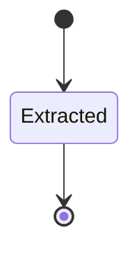
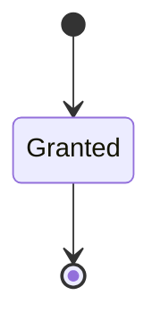
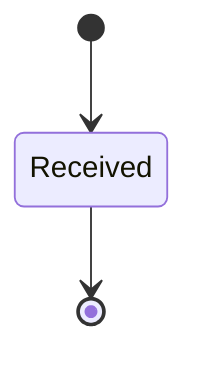
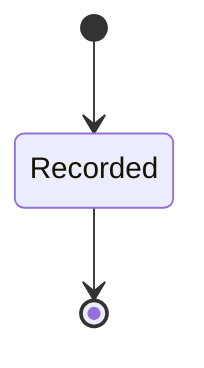
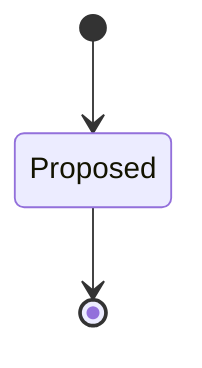
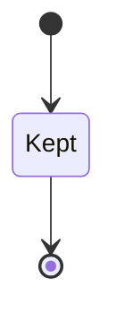
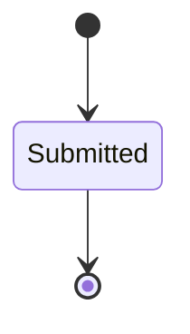

---
# generated by loom-docs, do not edit
title: "Routing domain"
sidebar_label: "Routing"
description: "ESS reference for the Routing domain, generated from the specification."
custom_edit_url: null
---

<!-- generated by loom-docs, do not edit -->

# Routing

An intent as given, the references extracted from its text, the protocol the router proposes for it, the slice run that works the intent until it is blocked, and the evidence that run submits from what it did itself. A pick is a proposal, never authority.

`intake.routing` is one of intake's bounded contexts. [All domains](./index.mdx).

## Types

### `AcceptedRoute`

`intake.routing.AcceptedRoute` is a record of five fields:

- `protocol` — `String`
- `intent_revision` — `String`
- `catalog` — `List<intake.routing.CatalogDigest>`
- `context_policy` — `intake.context.ContextPolicy`
- `threshold` — `Decimal`

### `ActionRequestId`

`intake.routing.ActionRequestId` wraps `Uuid` and is not interchangeable with one: the whole value of naming it separately is the crossings the model then refuses.

### `AgentRevisionId`

`intake.routing.AgentRevisionId` wraps `Uuid` and is not interchangeable with one: the whole value of naming it separately is the crossings the model then refuses.

### `CaseId`

`intake.routing.CaseId` wraps `String` and is not interchangeable with one: the whole value of naming it separately is the crossings the model then refuses.

### `CaseInputs`

`intake.routing.CaseInputs` is a record of three fields:

- `risk` — `intake.routing.Risk`
- `change_kind` — `intake.routing.ChangeKind`
- `affects_security_boundary` — `Boolean`

### `CatalogDigest`

`intake.routing.CatalogDigest` is a record of two fields:

- `name` — `String`
- `digest` — `String`

### `ChangeKind`

`intake.routing.ChangeKind` is one of `Feature`, `Bugfix` and `Refactor`.

### `CommissionId`

`intake.routing.CommissionId` wraps `Uuid` and is not interchangeable with one: the whole value of naming it separately is the crossings the model then refuses.

### `IntentId`

`intake.routing.IntentId` wraps `Uuid` and is not interchangeable with one: the whole value of naming it separately is the crossings the model then refuses.

### `MandateApprovalEntry`

`intake.routing.MandateApprovalEntry` is one of two shapes, told apart by a `kind` field — tagged, so a decoder never has to guess which branch it is reading:

- `ApprovalRecorded` — `intake.routing.MandateApprovalRecorded`
- `ApprovedDecisionRecorded` — `intake.routing.MandateApprovedDecision`

### `MandateApprovalId`

`intake.routing.MandateApprovalId` wraps `Uuid` and is not interchangeable with one: the whole value of naming it separately is the crossings the model then refuses.

### `MandateApprovalRecorded`

`intake.routing.MandateApprovalRecorded` is a record of 12 fields:

- `approval` — `intake.routing.MandateApprovalId`
- `commission_id` — `intake.routing.CommissionId`
- `action_request_id` — `intake.routing.ActionRequestId`
- `organization` — `Uuid`
- `subject` — `Uuid`
- `actor` — `Optional<Uuid>`, which may be absent
- `action` — `String`
- `resource_type` — `String`
- `resource_id` — `Uuid`
- `approver` — `Uuid`
- `recorded_at` — `Timestamp`
- `expires_at` — `Timestamp`

### `MandateApprovedDecision`

`intake.routing.MandateApprovedDecision` is a record of six fields:

- `approval` — `intake.routing.MandateApprovalId`
- `commission_id` — `intake.routing.CommissionId`
- `action_request_id` — `intake.routing.ActionRequestId`
- `context` — `Json`
- `decision` — `Json`
- `recorded_at` — `Timestamp`

### `ReferenceKind`

`intake.routing.ReferenceKind` is one of `JiraIssue`, `SlackMessage`, `GitlabIssue`, `GitlabMergeRequest`, `GithubIssue`, `GithubPullRequest` and `Url`.

### `Risk`

`intake.routing.Risk` is one of `Trivial`, `Standard`, `Elevated` and `Critical`.

### `SliceEvidenceKind`

`intake.routing.SliceEvidenceKind` is one of `TestResult`, `RegressionTestResult` and `ImplementationChange`.

### `SliceEvidenceResult`

`intake.routing.SliceEvidenceResult` is one of `Pass` and `Fail`.

### `StopReason`

`intake.routing.StopReason` is one of `ApprovalRequired`, `NothingAdmissible`, `StepBudget`, `NoLocalExecutor`, `Refused`, `ConfinementUnavailable` and `Completed`.

Two of the types above are reached by nothing else in this system: `intake.routing.CaseInputs` and `intake.routing.MandateApprovalEntry`. No entity, view, command, event, error or crossing names them, so it is either vocabulary something outside this specification uses or a leftover — and only a person can tell which.

## Entities

An entity is what this context is about: something with an identity that outlives any one request, a shape, and a lifecycle. The lifecycle is exhaustive — a move that is not drawn below is a move this specification does not permit, and that is the only way it says so. Every move is labelled with the command that takes it, because a move nothing can trigger is refused rather than drawn.

### `ExtractedReference`

`intake.routing.ExtractedReference`.

An instance is identified by `reference_id`, a `Uuid`. The name is part of the model and not a convention: a view projects the identity under that name, so a projection inventing its own would disagree with the view.

It holds:

- `intent_id` — `intake.routing.IntentId`
- `kind` — `intake.routing.ReferenceKind`
- `value` — `String`

Its `intent_id` is what [`Intent`](#intent) owns it by, as `references`.

No invariant is declared, so nothing here constrains an instance at rest.

Its state is a `intake.routing.ExtractedReference.State`, one of `Extracted`. That enum is synthesised from the lifecycle rather than declared beside it, so the states a view's filter compares and the states drawn below cannot disagree.

An instance is created in `Extracted`. `Extracted` is terminal, so an instance may rest there forever. That is declared rather than inferred from having no way out: an entity that cannot leave a state is either finished or stuck, and only its author knows which.

It declares no moves, so nothing changes its state once it exists.

It has one state, so there is no move to permit or to forbid.

No view projects it, so nothing outside this context is promised a way to observe one.

### `Grant`

`intake.routing.Grant`.

An instance is identified by `commission_id`, a `intake.routing.CommissionId`. The name is part of the model and not a convention: a view projects the identity under that name, so a projection inventing its own would disagree with the view.

It holds:

- `action` — `String`
- `capability` — `String`
- `granted` — `Boolean`
- `action_request_id` — `intake.routing.ActionRequestId`
- `granted_at` — `Timestamp`
- `mandate_approval` — `Optional<intake.routing.MandateApprovalId>`, which may be absent

It declares no relation to another entity, and no other entity names it.

No invariant is declared, so nothing here constrains an instance at rest.

Its state is a `intake.routing.Grant.State`, one of `Granted`. That enum is synthesised from the lifecycle rather than declared beside it, so the states a view's filter compares and the states drawn below cannot disagree.

An instance is created in `Granted`. `Granted` is terminal, so an instance may rest there forever. That is declared rather than inferred from having no way out: an entity that cannot leave a state is either finished or stuck, and only its author knows which.

It declares no moves, so nothing changes its state once it exists.

It has one state, so there is no move to permit or to forbid.

No view projects it, so nothing outside this context is promised a way to observe one.

### `Intent`

`intake.routing.Intent`.

An instance is identified by `intent_id`, a `intake.routing.IntentId`. The name is part of the model and not a convention: a view projects the identity under that name, so a projection inventing its own would disagree with the view.

It holds:

- `text` — `String`

It owns any number of [`ExtractedReference`](#extractedreference), as `references`, carried by `ExtractedReference.intent_id`. It owns at most one [`ProtocolPick`](#protocolpick), as `pick`, carried by `ProtocolPick.intent_id`.

No invariant is declared, so nothing here constrains an instance at rest.

Its state is a `intake.routing.Intent.State`, one of `Received`. That enum is synthesised from the lifecycle rather than declared beside it, so the states a view's filter compares and the states drawn below cannot disagree.

An instance is created in `Received`. `Received` is terminal, so an instance may rest there forever. That is declared rather than inferred from having no way out: an entity that cannot leave a state is either finished or stuck, and only its author knows which.

It declares no moves, so nothing changes its state once it exists.

It has one state, so there is no move to permit or to forbid.

No view projects it, so nothing outside this context is promised a way to observe one.

### `MergeHandoff`

`intake.routing.MergeHandoff`.

An instance is identified by `action_request_id`, a `intake.routing.ActionRequestId`. The name is part of the model and not a convention: a view projects the identity under that name, so a projection inventing its own would disagree with the view.

It holds:

- `commission_id` — `intake.routing.CommissionId`
- `workspace` — `String`
- `head` — `String`

It declares no relation to another entity, and no other entity names it.

No invariant is declared, so nothing here constrains an instance at rest.

Its state is a `intake.routing.MergeHandoff.State`, one of `Recorded`. That enum is synthesised from the lifecycle rather than declared beside it, so the states a view's filter compares and the states drawn below cannot disagree.

An instance is created in `Recorded`. `Recorded` is terminal, so an instance may rest there forever. That is declared rather than inferred from having no way out: an entity that cannot leave a state is either finished or stuck, and only its author knows which.

It declares no moves, so nothing changes its state once it exists.

It has one state, so there is no move to permit or to forbid.

One view projects it: [`MergeHandoffs`](#mergehandoffs).

### `ProtocolPick`

`intake.routing.ProtocolPick`.

An instance is identified by `pick_id`, a `Uuid`. The name is part of the model and not a convention: a view projects the identity under that name, so a projection inventing its own would disagree with the view.

It holds:

- `intent_id` — `intake.routing.IntentId`
- `protocol` — `String`
- `confidence` — `Decimal`
- `reasons` — `List<String>`

Its `intent_id` is what [`Intent`](#intent) owns it by, as `pick`.

No invariant is declared, so nothing here constrains an instance at rest.

Its state is a `intake.routing.ProtocolPick.State`, one of `Proposed`. That enum is synthesised from the lifecycle rather than declared beside it, so the states a view's filter compares and the states drawn below cannot disagree.

An instance is created in `Proposed`. `Proposed` is terminal, so an instance may rest there forever. That is declared rather than inferred from having no way out: an entity that cannot leave a state is either finished or stuck, and only its author knows which.

It declares no moves, so nothing changes its state once it exists.

It has one state, so there is no move to permit or to forbid.

No view projects it, so nothing outside this context is promised a way to observe one.

### `ResumeContext`

`intake.routing.ResumeContext`.

An instance is identified by `commission_id`, a `intake.routing.CommissionId`. The name is part of the model and not a convention: a view projects the identity under that name, so a projection inventing its own would disagree with the view.

It holds:

- `case_id` — `intake.routing.CaseId`
- `agent_revision_id` — `intake.routing.AgentRevisionId`
- `intent` — `String`
- `route` — `intake.routing.AcceptedRoute`
- `workspace` — `Optional<String>`, which may be absent
- `test_command` — `List<String>`
- `test_paths` — `List<String>`
- `regression_test_command` — `Optional<String>`, which may be absent
- `max_steps` — `Integer`
- `confinement` — `intake.confinement.Backend`
- `cgroup_root` — `Optional<String>`, which may be absent
- `model` — `String`
- `catalog` — `Optional<String>`, which may be absent
- `config` — `Optional<String>`, which may be absent

It declares no relation to another entity, and no other entity names it.

No invariant is declared, so nothing here constrains an instance at rest.

Its state is a `intake.routing.ResumeContext.State`, one of `Kept`. That enum is synthesised from the lifecycle rather than declared beside it, so the states a view's filter compares and the states drawn below cannot disagree.

An instance is created in `Kept`. `Kept` is terminal, so an instance may rest there forever. That is declared rather than inferred from having no way out: an entity that cannot leave a state is either finished or stuck, and only its author knows which.

It declares no moves, so nothing changes its state once it exists.

It has one state, so there is no move to permit or to forbid.

One view projects it: [`ResumeContexts`](#resumecontexts).

### `SliceEvidence`

`intake.routing.SliceEvidence`.

An instance is identified by `evidence_id`, a `Uuid`. The name is part of the model and not a convention: a view projects the identity under that name, so a projection inventing its own would disagree with the view.

It holds:

- `kind` — `intake.routing.SliceEvidenceKind`
- `subject_revision` — `String`
- `result` — `Optional<intake.routing.SliceEvidenceResult>`, which may be absent
- `observation_id` — `Uuid`
- `observed_at` — `Timestamp`
- `producer` — `String`

It declares no relation to another entity, and no other entity names it.

No invariant is declared, so nothing here constrains an instance at rest.

Its state is a `intake.routing.SliceEvidence.State`, one of `Submitted`. That enum is synthesised from the lifecycle rather than declared beside it, so the states a view's filter compares and the states drawn below cannot disagree.

An instance is created in `Submitted`. `Submitted` is terminal, so an instance may rest there forever. That is declared rather than inferred from having no way out: an entity that cannot leave a state is either finished or stuck, and only its author knows which.

It declares no moves, so nothing changes its state once it exists.

It has one state, so there is no move to permit or to forbid.

No view projects it, so nothing outside this context is promised a way to observe one.

### `SliceRun`

`intake.routing.SliceRun`.

An instance is identified by `run_id`, a `Uuid`. The name is part of the model and not a convention: a view projects the identity under that name, so a projection inventing its own would disagree with the view.

It holds:

- `intent_id` — `intake.routing.IntentId`
- `protocol` — `String`
- `steps` — `Integer`
- `stop_reason` — `intake.routing.StopReason`
- `approvals` — `List<String>`
- `risk` — `intake.routing.Risk`
- `change_kind` — `intake.routing.ChangeKind`
- `affects_security_boundary` — `Boolean`
- `test_paths` — `List<String>`
- `regression_test_command` — `Optional<String>`, which may be absent

It references at most one [`Intent`](#intent), as `intent`, carried by `SliceRun.intent_id`.

No invariant is declared, so nothing here constrains an instance at rest.

Its state is a `intake.routing.SliceRun.State`, one of `Ended`. That enum is synthesised from the lifecycle rather than declared beside it, so the states a view's filter compares and the states drawn below cannot disagree.

An instance is created in `Ended`. `Ended` is terminal, so an instance may rest there forever. That is declared rather than inferred from having no way out: an entity that cannot leave a state is either finished or stuck, and only its author knows which.

It declares no moves, so nothing changes its state once it exists.

It has one state, so there is no move to permit or to forbid.

No view projects it, so nothing outside this context is promised a way to observe one.

## Views

A view is what the outside world is promised it can observe. Each one says which instances it contains and how soon it reflects a command that has already returned, because "you can read this" without "how soon" is the promise every flaky suite is built on.

### `MergeHandoffs`

`intake.routing.MergeHandoffs`.

It reads [`MergeHandoff`](#mergehandoff).

It contains every instance of that entity: no filter narrows it, which is a decision somebody made and not a line somebody omitted.

It exposes:

- `action_request_id` — `intake.routing.ActionRequestId`
- `commission_id` — `intake.routing.CommissionId`
- `workspace` — `String`
- `head` — `String`
- `state` — `intake.routing.MergeHandoff.State`

It declares no order, so the rows come back in whatever order the implementation has, and two reads may disagree.

**Read-your-writes**: it is current the moment the command that changed it returns. A caller that has just created an invoice and cannot see it in here has been told a lie about what it did.

A generated scenario asserts it once, immediately after the command: a view promising this and not keeping the promise has to fail the suite rather than be retried until it passes.

### `ResumeContexts`

`intake.routing.ResumeContexts`.

It reads [`ResumeContext`](#resumecontext).

It contains every instance of that entity: no filter narrows it, which is a decision somebody made and not a line somebody omitted.

It exposes:

- `commission_id` — `intake.routing.CommissionId`
- `case_id` — `intake.routing.CaseId`
- `agent_revision_id` — `intake.routing.AgentRevisionId`
- `intent` — `String`
- `workspace` — `Optional<String>`, which may be absent
- `test_command` — `List<String>`
- `test_paths` — `List<String>`
- `regression_test_command` — `Optional<String>`, which may be absent
- `max_steps` — `Integer`
- `confinement` — `intake.confinement.Backend`
- `cgroup_root` — `Optional<String>`, which may be absent
- `model` — `String`
- `catalog` — `Optional<String>`, which may be absent
- `config` — `Optional<String>`, which may be absent
- `state` — `intake.routing.ResumeContext.State`

It declares no order, so the rows come back in whatever order the implementation has, and two reads may disagree.

**Read-your-writes**: it is current the moment the command that changed it returns. A caller that has just created an invoice and cannot see it in here has been told a lie about what it did.

A generated scenario asserts it once, immediately after the command: a view promising this and not keeping the promise has to fail the suite rather than be retried until it passes.

## Commands

### `DropResumeContext`

`intake.routing.DropResumeContext`.

It takes:

- `commission_id` — `intake.routing.CommissionId`

It has three outcomes.

**`dropped`** — The default branch, taken when no other outcome's condition matched. It removes the `intake.routing.ResumeContext` its input names; no view shows it afterwards. The instance is the one named by the input field `commission_id`. It emits nothing. A test reaches it by constructing an input that satisfies no other outcome's condition.

**`not-found`** — Taken when the identity the command names is one no record carries, before any other answer for it. No entity in this specification changes. It reports `intake.routing.ResumeContextNotFound`, carrying `commission_id`. It emits nothing. A test reaches it by sending an identity no record carries, arranging nothing.

**`storage-failed`** — Decided outside the input: the resume context store cannot remove the context. No predicate over the input reaches this branch, and saying `when: false` instead would have claimed it is unreachable, which is a different and false statement. No entity in this specification changes. It reports `intake.routing.ResumeContextStorageFailed`, carrying `reason`. It emits nothing. A test reaches it by injecting the declared fault, because no input can.

### `KeepResumeContext`

`intake.routing.KeepResumeContext`.

It takes:

- `commission_id` — `intake.routing.CommissionId`
- `case_id` — `intake.routing.CaseId`
- `agent_revision_id` — `intake.routing.AgentRevisionId`
- `intent` — `String`
- `route` — `intake.routing.AcceptedRoute`
- `workspace` — `Optional<String>`, which may be absent
- `test_command` — `List<String>`
- `test_paths` — `List<String>`
- `regression_test_command` — `Optional<String>`, which may be absent
- `max_steps` — `Integer`
- `confinement` — `intake.confinement.Backend`
- `cgroup_root` — `Optional<String>`, which may be absent
- `model` — `String`
- `catalog` — `Optional<String>`, which may be absent
- `config` — `Optional<String>`, which may be absent

It has four outcomes.

**`config-and-catalog`** — Taken when `(defined(config) and defined(catalog))` holds of the input. No entity in this specification changes. It reports `intake.routing.ResumeContextConfigAndCatalog`, carrying `commission_id`. It emits nothing. A test reaches it by constructing an input that satisfies that condition.

**`already-kept`** — Taken when a record already carries the identity the command's creating branch would create, and no input-guarded refusal applies. No entity in this specification changes. It reports `intake.routing.ResumeContextAlreadyKept`, carrying `commission_id`. It emits nothing. A test reaches it by sending the command twice with one identity: the first call creates the record, the second is answered by this branch.

**`kept`** — The default branch, taken when no other outcome's condition matched. It creates a `intake.routing.ResumeContext`, which starts in `Kept`. The new instance's identity is published as `commission_id` on `intake.routing.ResumeContextKept`. It emits `intake.routing.ResumeContextKept`. It sets `case_id` from `input.case_id`, `agent_revision_id` from `input.agent_revision_id`, `intent` from `input.intent`, `route` from `input.route`, `workspace` from `input.workspace`, `test_command` from `input.test_command`, `test_paths` from `input.test_paths`, `regression_test_command` from `input.regression_test_command`, `max_steps` from `input.max_steps`, `confinement` from `input.confinement`, `cgroup_root` from `input.cgroup_root`, `model` from `input.model`, `catalog` from `input.catalog` and `config` from `input.config`. A test reaches it by constructing an input that satisfies no other outcome's condition.

**`storage-failed`** — Decided outside the input: the resume context store cannot keep the context. No predicate over the input reaches this branch, and saying `when: false` instead would have claimed it is unreachable, which is a different and false statement. No entity in this specification changes. It reports `intake.routing.ResumeContextStorageFailed`, carrying `reason`. It emits nothing. A test reaches it by injecting the declared fault, because no input can.

### `RecordMergeHandoff`

`intake.routing.RecordMergeHandoff`.

It takes:

- `action_request_id` — `intake.routing.ActionRequestId`
- `commission_id` — `intake.routing.CommissionId`
- `workspace` — `String`
- `head` — `String`

It has four outcomes.

**`already-recorded`** — Taken when a record already carries the identity the command's creating branch would create, and no input-guarded refusal applies. No entity in this specification changes. It reports `intake.routing.MergeHandoffAlreadyRecorded`, carrying `action_request_id`. It emits nothing. A test reaches it by sending the command twice with one identity: the first call creates the record, the second is answered by this branch.

**`head-already-handed-off`** — Taken when, of the `intake.routing.MergeHandoff` rows whose stored fields satisfy `(commission_id == input.commission_id and head == input.head)` before the outcome, at least one row is selected. No entity in this specification changes. It reports `intake.routing.HeadAlreadyHandedOff`, carrying `commission_id` and `head`. It emits nothing. A test reaches it by arranging the row of the other entity the input names, or its absence, and sending the command for it.

**`recorded`** — The default branch, taken when no other outcome's condition matched. It creates a `intake.routing.MergeHandoff`, which starts in `Recorded`. The new instance's identity is published as `action_request_id` on `intake.routing.MergeHandedOff`. It emits `intake.routing.MergeHandedOff`. It sets `commission_id` from `input.commission_id`, `workspace` from `input.workspace` and `head` from `input.head`. A test reaches it by constructing an input that satisfies no other outcome's condition.

**`storage-failed`** — Decided outside the input: the state directory cannot record the hand-off. No predicate over the input reaches this branch, and saying `when: false` instead would have claimed it is unreachable, which is a different and false statement. No entity in this specification changes. It reports `intake.routing.MergeHandoffStorageFailed`, carrying `reason`. It emits nothing. A test reaches it by injecting the declared fault, because no input can.

## Events

### `MergeHandedOff`

`intake.routing.MergeHandedOff`.

It carries:

- `action_request_id` — `intake.routing.ActionRequestId`
- `commission_id` — `intake.routing.CommissionId`
- `workspace` — `String`
- `head` — `String`

Emitted by `intake.routing.RecordMergeHandoff` on its `recorded` outcome.

Nothing in this system reacts to it.

### `ResumeContextKept`

`intake.routing.ResumeContextKept`.

It carries:

- `commission_id` — `intake.routing.CommissionId`
- `case_id` — `intake.routing.CaseId`

Emitted by `intake.routing.KeepResumeContext` on its `kept` outcome.

Nothing in this system reacts to it.

## Errors

### `HeadAlreadyHandedOff`

It carries:

- `commission_id` — `intake.routing.CommissionId`
- `head` — `String`

Reported by `intake.routing.RecordMergeHandoff` on its `head-already-handed-off` outcome.

### `MergeHandoffAlreadyRecorded`

It carries:

- `action_request_id` — `intake.routing.ActionRequestId`

Reported by `intake.routing.RecordMergeHandoff` on its `already-recorded` outcome.

### `MergeHandoffStorageFailed`

It carries:

- `reason` — `String`

Reported by `intake.routing.RecordMergeHandoff` on its `storage-failed` outcome.

### `ResumeContextAlreadyKept`

It carries:

- `commission_id` — `intake.routing.CommissionId`

Reported by `intake.routing.KeepResumeContext` on its `already-kept` outcome.

### `ResumeContextConfigAndCatalog`

It carries:

- `commission_id` — `intake.routing.CommissionId`

Reported by `intake.routing.KeepResumeContext` on its `config-and-catalog` outcome.

### `ResumeContextNotFound`

It carries:

- `commission_id` — `intake.routing.CommissionId`

Reported by `intake.routing.DropResumeContext` on its `not-found` outcome.

### `ResumeContextStorageFailed`

It carries:

- `reason` — `String`

Reported by `intake.routing.DropResumeContext` on its `storage-failed` outcome.

Reported by `intake.routing.KeepResumeContext` on its `storage-failed` outcome.

---

Generated from intake v1 · model digest `91e7b24c1442a41a622f4feaa84db250d7769d7784122bae93f2e0cda0c64c8e` · contract digest `slice-sha256/2:b36ff8dcaf61feb22affa0e8ca3ec9ddb9c4fcfd0a95479650b3eafe34a6f0a3`. Do not edit this file; change the specification and regenerate it with `task docs-generate`.
