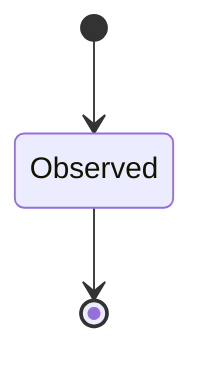
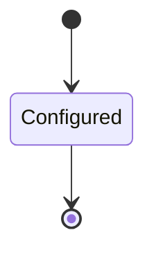
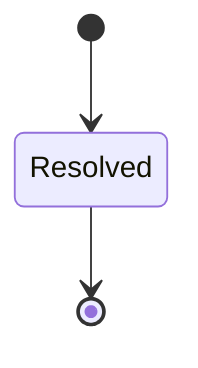
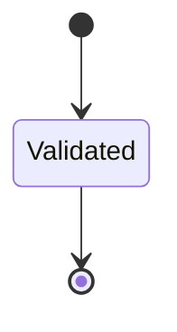

---
# generated by loom-docs, do not edit
title: "dashboard domain"
sidebar_label: "dashboard"
description: "ESS reference for the dashboard domain, generated from the specification."
custom_edit_url: null
---

<!-- generated by loom-docs, do not edit -->

# dashboard

The operator's read model for a single server. The server observes hosts and turns. The browser uses these views of its authorized snapshot.

`loom.dashboard` is one of loom's bounded contexts. [All domains](./index.mdx).

## Types

### `Agent`

`loom.dashboard.Agent` is a record of 14 fields:

- `id` — `String`
- `spec_id` — `String`
- `kind` — `Optional<loom.dashboard.AgentKind>`, which may be absent
- `harness` — `Optional<loom.dashboard.Harness>`, which may be absent
- `spec_revision` — `Optional<String>`, which may be absent
- `protocol` — `Optional<String>`, which may be absent
- `a2a_protocol` — `Optional<String>`, which may be absent
- `poll_interval_seconds` — `Optional<Integer>`, which may be absent
- `name` — `String`
- `instance` — `String`
- `status` — `loom.dashboard.AgentStatus`
- `last_seen` — `Timestamp`
- `current` — `List<loom.dashboard.Run>`
- `model` — `Optional<String>`, which may be absent

### `AgentKind`

`loom.dashboard.AgentKind` is one of `agent_spec` and `session`.

### `AgentRouting`

`loom.dashboard.AgentRouting` is a record of three fields:

- `source` — `loom.dashboard.RoutingSource`
- `agent` — `loom.dashboard.ModelRoute`
- `classifier` — `loom.dashboard.ModelRoute`

### `AgentStatus`

`loom.dashboard.AgentStatus` is one of `idle`, `working` and `offline`.

### `Coverage`

`loom.dashboard.Coverage` is a record of five fields:

- `total` — `Integer`
- `cost` — `Integer`
- `input_tokens` — `Integer`
- `output_tokens` — `Integer`
- `model_calls` — `Integer`

### `Harness`

`loom.dashboard.Harness` is one of `native`, `claude` and `codex`.

### `LaunchStatus`

`loom.dashboard.LaunchStatus` is one of `started` and `already_running`.

### `LaunchTemplate`

`loom.dashboard.LaunchTemplate` is a record of seven fields:

- `id` — `loom.observation.LaunchKey`
- `name` — `String`
- `spec_id` — `String`
- `kind` — `loom.dashboard.AgentKind`
- `default_harness` — `loom.dashboard.Harness`
- `harnesses` — `List<loom.dashboard.Harness>`
- `protocol` — `Optional<String>`, which may be absent

### `ModelProtocol`

`loom.dashboard.ModelProtocol` is one of `chat-completions`, `responses` and `messages`.

### `ModelRoute`

`loom.dashboard.ModelRoute` is a record of seven fields:

- `selection` — `Optional<String>`, which may be absent
- `upstream_model` — `Optional<String>`, which may be absent
- `endpoint_id` — `Optional<String>`, which may be absent
- `base_origin` — `Optional<String>`, which may be absent
- `protocol` — `loom.dashboard.ModelProtocol`
- `provider_id` — `Optional<String>`, which may be absent
- `binding_revision` — `Optional<String>`, which may be absent

### `RoutingSource`

`loom.dashboard.RoutingSource` is one of `launch_catalog` and `spec_routes`.

### `Run`

`loom.dashboard.Run` is a record of 17 fields:

- `id` — `loom.observation.RunId`
- `agent_id` — `String`
- `item_id` — `String`
- `outcome` — `String`
- `action` — `String`
- `started_at` — `Optional<Timestamp>`, which may be absent
- `ended_at` — `Optional<Timestamp>`, which may be absent
- `steps` — `List<loom.dashboard.Step>`
- `steps_left` — `Optional<Integer>`, which may be absent
- `model_calls_left` — `Optional<Integer>`, which may be absent
- `events` — `List<loom.dashboard.TurnEvent>`
- `stop_reason` — `Optional<String>`, which may be absent
- `model_calls` — `Optional<Integer>`, which may be absent
- `input_tokens` — `Optional<Integer>`, which may be absent
- `output_tokens` — `Optional<Integer>`, which may be absent
- `cost_micro_usd` — `Optional<Integer>`, which may be absent
- `cost` — `Optional<Binary64>`, which may be absent

### `SnapshotData`

`loom.dashboard.SnapshotData` is a record of seven fields:

- `server` — `String`
- `time` — `Timestamp`
- `cursor` — `String`
- `agents` — `List<loom.dashboard.Agent>`
- `runs` — `List<loom.dashboard.Run>`
- `stats` — `loom.dashboard.Stats`
- `partial` — `Boolean`

### `Stats`

`loom.dashboard.Stats` is a record of 18 fields:

- `active` — `Integer`
- `total` — `Integer`
- `completed` — `Integer`
- `failed` — `Integer`
- `rejected` — `Integer`
- `latency_samples` — `Integer`
- `p50_ms` — `Optional<Integer>`, which may be absent
- `p95_ms` — `Optional<Integer>`, which may be absent
- `model_calls` — `Optional<Integer>`, which may be absent
- `input_tokens` — `Optional<Integer>`, which may be absent
- `output_tokens` — `Optional<Integer>`, which may be absent
- `cost_micro_usd` — `Optional<Integer>`, which may be absent
- `cost` — `Optional<Binary64>`, which may be absent
- `currency` — `Optional<String>`, which may be absent
- `throughput_per_hour` — `Optional<Binary64>`, which may be absent
- `refused_steps` — `Integer`
- `budget_stops` — `Integer`
- `coverage` — `loom.dashboard.Coverage`

### `Step`

`loom.dashboard.Step` is a record of four fields:

- `action` — `String`
- `outcome` — `String`
- `steps_left` — `Optional<Integer>`, which may be absent
- `model_calls_left` — `Optional<Integer>`, which may be absent

### `TurnEvent`

`loom.dashboard.TurnEvent` is a record of four fields:

- `kind` — `String`
- `time` — `Timestamp`
- `action` — `Optional<String>`, which may be absent
- `outcome` — `Optional<String>`, which may be absent

Four of the types above are reached by nothing else in this system: `loom.dashboard.AgentRouting`, `loom.dashboard.LaunchStatus`, `loom.dashboard.LaunchTemplate` and `loom.dashboard.SnapshotData`. No entity, view, command, event, error or crossing names them, so it is either vocabulary something outside this specification uses or a leftover — and only a person can tell which.

## Entities

An entity is what this context is about: something with an identity that outlives any one request, a shape, and a lifecycle. The lifecycle is exhaustive — a move that is not drawn below is a move this specification does not permit, and that is the only way it says so. Every move is labelled with the command that takes it, because a move nothing can trigger is refused rather than drawn.

### `AgentObservation`

`loom.dashboard.AgentObservation`.

An instance is identified by `id`, a `String`. The name is part of the model and not a convention: a view projects the identity under that name, so a projection inventing its own would disagree with the view.

It holds:

- `spec_id` — `String`
- `kind` — `Optional<loom.dashboard.AgentKind>`, which may be absent
- `harness` — `Optional<loom.dashboard.Harness>`, which may be absent
- `spec_revision` — `Optional<String>`, which may be absent
- `protocol` — `Optional<String>`, which may be absent
- `a2a_protocol` — `Optional<String>`, which may be absent
- `poll_interval_seconds` — `Optional<Integer>`, which may be absent
- `name` — `String`
- `instance` — `String`
- `status` — `loom.dashboard.AgentStatus`
- `last_seen` — `Timestamp`
- `current` — `List<loom.dashboard.Run>`
- `model` — `Optional<String>`, which may be absent

It declares no relation to another entity, and no other entity names it.

No invariant is declared, so nothing here constrains an instance at rest.

Its state is a `loom.dashboard.AgentObservation.State`, one of `Observed`. That enum is synthesised from the lifecycle rather than declared beside it, so the states a view's filter compares and the states drawn below cannot disagree.

An instance is created in `Observed`. `Observed` is terminal, so an instance may rest there forever. That is declared rather than inferred from having no way out: an entity that cannot leave a state is either finished or stuck, and only its author knows which.

It declares no moves, so nothing changes its state once it exists.

It has one state, so there is no move to permit or to forbid.

Two views project it: [`AgentById`](#agentbyid) and [`Agents`](#agents).

### `ConfiguredTemplate`

`loom.dashboard.ConfiguredTemplate`.

An instance is identified by `id`, a `loom.observation.LaunchKey`. The name is part of the model and not a convention: a view projects the identity under that name, so a projection inventing its own would disagree with the view.

It holds:

- `name` — `String`
- `spec_id` — `String`
- `kind` — `loom.dashboard.AgentKind`
- `default_harness` — `loom.dashboard.Harness`
- `harnesses` — `List<loom.dashboard.Harness>`
- `protocol` — `Optional<String>`, which may be absent

It declares no relation to another entity, and no other entity names it.

No invariant is declared, so nothing here constrains an instance at rest.

Its state is a `loom.dashboard.ConfiguredTemplate.State`, one of `Configured`. That enum is synthesised from the lifecycle rather than declared beside it, so the states a view's filter compares and the states drawn below cannot disagree.

An instance is created in `Configured`. `Configured` is terminal, so an instance may rest there forever. That is declared rather than inferred from having no way out: an entity that cannot leave a state is either finished or stuck, and only its author knows which.

It declares no moves, so nothing changes its state once it exists.

It has one state, so there is no move to permit or to forbid.

One view projects it: [`LaunchTemplates`](#launchtemplates).

### `RegisteredRouting`

`loom.dashboard.RegisteredRouting`.

An instance is identified by `id`, a `String`. The name is part of the model and not a convention: a view projects the identity under that name, so a projection inventing its own would disagree with the view.

It holds:

- `source` — `loom.dashboard.RoutingSource`
- `agent` — `loom.dashboard.ModelRoute`
- `classifier` — `loom.dashboard.ModelRoute`

It declares no relation to another entity, and no other entity names it.

No invariant is declared, so nothing here constrains an instance at rest.

Its state is a `loom.dashboard.RegisteredRouting.State`, one of `Resolved`. That enum is synthesised from the lifecycle rather than declared beside it, so the states a view's filter compares and the states drawn below cannot disagree.

An instance is created in `Resolved`. `Resolved` is terminal, so an instance may rest there forever. That is declared rather than inferred from having no way out: an entity that cannot leave a state is either finished or stuck, and only its author knows which.

It declares no moves, so nothing changes its state once it exists.

It has one state, so there is no move to permit or to forbid.

One view projects it: [`AgentRoutingById`](#agentroutingbyid).

### `RegisteredSpec`

`loom.dashboard.RegisteredSpec`.

An instance is identified by `id`, a `String`. The name is part of the model and not a convention: a view projects the identity under that name, so a projection inventing its own would disagree with the view.

It holds:

- `spec_revision` — `String`
- `source` — `String`

It declares no relation to another entity, and no other entity names it.

No invariant is declared, so nothing here constrains an instance at rest.

Its state is a `loom.dashboard.RegisteredSpec.State`, one of `Validated`. That enum is synthesised from the lifecycle rather than declared beside it, so the states a view's filter compares and the states drawn below cannot disagree.

An instance is created in `Validated`. `Validated` is terminal, so an instance may rest there forever. That is declared rather than inferred from having no way out: an entity that cannot leave a state is either finished or stuck, and only its author knows which.

It declares no moves, so nothing changes its state once it exists.

It has one state, so there is no move to permit or to forbid.

One view projects it: [`AgentSpecById`](#agentspecbyid).

### `RunObservation`

`loom.dashboard.RunObservation`.

An instance is identified by `id`, a `loom.observation.RunId`. The name is part of the model and not a convention: a view projects the identity under that name, so a projection inventing its own would disagree with the view.

It holds:

- `agent_id` — `String`
- `item_id` — `String`
- `outcome` — `String`
- `action` — `String`
- `started_at` — `Optional<Timestamp>`, which may be absent
- `ended_at` — `Optional<Timestamp>`, which may be absent
- `steps` — `List<loom.dashboard.Step>`
- `steps_left` — `Optional<Integer>`, which may be absent
- `model_calls_left` — `Optional<Integer>`, which may be absent
- `events` — `List<loom.dashboard.TurnEvent>`
- `stop_reason` — `Optional<String>`, which may be absent
- `model_calls` — `Optional<Integer>`, which may be absent
- `input_tokens` — `Optional<Integer>`, which may be absent
- `output_tokens` — `Optional<Integer>`, which may be absent
- `cost_micro_usd` — `Optional<Integer>`, which may be absent
- `cost` — `Optional<Binary64>`, which may be absent

It declares no relation to another entity, and no other entity names it.

No invariant is declared, so nothing here constrains an instance at rest.

Its state is a `loom.dashboard.RunObservation.State`, one of `Observed`. That enum is synthesised from the lifecycle rather than declared beside it, so the states a view's filter compares and the states drawn below cannot disagree.

An instance is created in `Observed`. `Observed` is terminal, so an instance may rest there forever. That is declared rather than inferred from having no way out: an entity that cannot leave a state is either finished or stuck, and only its author knows which.

It declares no moves, so nothing changes its state once it exists.

It has one state, so there is no move to permit or to forbid.

Two views project it: [`RunById`](#runbyid) and [`Runs`](#runs).

### `SnapshotDataObservation`

`loom.dashboard.SnapshotDataObservation`.

An instance is identified by `server`, a `String`. The name is part of the model and not a convention: a view projects the identity under that name, so a projection inventing its own would disagree with the view.

It holds:

- `time` — `Timestamp`
- `cursor` — `String`
- `agents` — `List<loom.dashboard.Agent>`
- `runs` — `List<loom.dashboard.Run>`
- `stats` — `loom.dashboard.Stats`
- `partial` — `Boolean`

It declares no relation to another entity, and no other entity names it.

No invariant is declared, so nothing here constrains an instance at rest.

Its state is a `loom.dashboard.SnapshotDataObservation.State`, one of `Observed`. That enum is synthesised from the lifecycle rather than declared beside it, so the states a view's filter compares and the states drawn below cannot disagree.

An instance is created in `Observed`. `Observed` is terminal, so an instance may rest there forever. That is declared rather than inferred from having no way out: an entity that cannot leave a state is either finished or stuck, and only its author knows which.

It declares no moves, so nothing changes its state once it exists.

It has one state, so there is no move to permit or to forbid.

One view projects it: [`Snapshot`](#snapshot).

### `StatsObservation`

`loom.dashboard.StatsObservation`.

An instance is identified by `scope`, a `String`. The name is part of the model and not a convention: a view projects the identity under that name, so a projection inventing its own would disagree with the view.

It holds:

- `active` — `Integer`
- `total` — `Integer`
- `completed` — `Integer`
- `failed` — `Integer`
- `rejected` — `Integer`
- `latency_samples` — `Integer`
- `p50_ms` — `Optional<Integer>`, which may be absent
- `p95_ms` — `Optional<Integer>`, which may be absent
- `model_calls` — `Optional<Integer>`, which may be absent
- `input_tokens` — `Optional<Integer>`, which may be absent
- `output_tokens` — `Optional<Integer>`, which may be absent
- `cost_micro_usd` — `Optional<Integer>`, which may be absent
- `cost` — `Optional<Binary64>`, which may be absent
- `currency` — `Optional<String>`, which may be absent
- `throughput_per_hour` — `Optional<Binary64>`, which may be absent
- `refused_steps` — `Integer`
- `budget_stops` — `Integer`
- `coverage` — `loom.dashboard.Coverage`

It declares no relation to another entity, and no other entity names it.

No invariant is declared, so nothing here constrains an instance at rest.

Its state is a `loom.dashboard.StatsObservation.State`, one of `Observed`. That enum is synthesised from the lifecycle rather than declared beside it, so the states a view's filter compares and the states drawn below cannot disagree.

An instance is created in `Observed`. `Observed` is terminal, so an instance may rest there forever. That is declared rather than inferred from having no way out: an entity that cannot leave a state is either finished or stuck, and only its author knows which.

It declares no moves, so nothing changes its state once it exists.

It has one state, so there is no move to permit or to forbid.

One view projects it: [`Statistics`](#statistics).

## Views

A view is what the outside world is promised it can observe. Each one says which instances it contains and how soon it reflects a command that has already returned, because "you can read this" without "how soon" is the promise every flaky suite is built on.

### `AgentById`

`loom.dashboard.AgentById`.

It reads [`AgentObservation`](#agentobservation).

It contains the instances where `id == param.id` holds, and only those — so an instance a caller cannot find in here has been filtered out rather than lost.

It exposes:

- `id` — `String`
- `spec_id` — `String`
- `kind` — `Optional<loom.dashboard.AgentKind>`, which may be absent
- `harness` — `Optional<loom.dashboard.Harness>`, which may be absent
- `spec_revision` — `Optional<String>`, which may be absent
- `protocol` — `Optional<String>`, which may be absent
- `a2a_protocol` — `Optional<String>`, which may be absent
- `poll_interval_seconds` — `Optional<Integer>`, which may be absent
- `name` — `String`
- `instance` — `String`
- `status` — `loom.dashboard.AgentStatus`
- `last_seen` — `Timestamp`
- `current` — `List<loom.dashboard.Run>`
- `model` — `Optional<String>`, which may be absent

It declares no order, so the rows come back in whatever order the implementation has, and two reads may disagree.

**Eventual**: it catches up some time after the command returns, so a caller that reads it immediately may legitimately not see its own write yet. Nothing here says how long that takes, so nothing here lets a caller wait a fixed time and call it correct.

A generated scenario therefore retries the assertion until the projection catches up, rather than asserting once and racing it. The repair everyone reaches for instead is a sleep, which turns the suite into a test of the machine it runs on.

### `AgentRoutingById`

`loom.dashboard.AgentRoutingById`.

It reads [`RegisteredRouting`](#registeredrouting).

It contains the instances where `id == param.id` holds, and only those — so an instance a caller cannot find in here has been filtered out rather than lost.

It exposes:

- `id` — `String`
- `source` — `loom.dashboard.RoutingSource`
- `agent` — `loom.dashboard.ModelRoute`
- `classifier` — `loom.dashboard.ModelRoute`

It declares no order, so the rows come back in whatever order the implementation has, and two reads may disagree.

**Eventual**: it catches up some time after the command returns, so a caller that reads it immediately may legitimately not see its own write yet. Nothing here says how long that takes, so nothing here lets a caller wait a fixed time and call it correct.

A generated scenario therefore retries the assertion until the projection catches up, rather than asserting once and racing it. The repair everyone reaches for instead is a sleep, which turns the suite into a test of the machine it runs on.

### `AgentSpecById`

`loom.dashboard.AgentSpecById`.

It reads [`RegisteredSpec`](#registeredspec).

It contains the instances where `id == param.id` holds, and only those — so an instance a caller cannot find in here has been filtered out rather than lost.

It exposes:

- `id` — `String`
- `spec_revision` — `String`
- `source` — `String`

It declares no order, so the rows come back in whatever order the implementation has, and two reads may disagree.

**Eventual**: it catches up some time after the command returns, so a caller that reads it immediately may legitimately not see its own write yet. Nothing here says how long that takes, so nothing here lets a caller wait a fixed time and call it correct.

A generated scenario therefore retries the assertion until the projection catches up, rather than asserting once and racing it. The repair everyone reaches for instead is a sleep, which turns the suite into a test of the machine it runs on.

### `Agents`

`loom.dashboard.Agents`.

It reads [`AgentObservation`](#agentobservation).

It contains every instance of that entity: no filter narrows it, which is a decision somebody made and not a line somebody omitted.

It exposes:

- `id` — `String`
- `spec_id` — `String`
- `kind` — `Optional<loom.dashboard.AgentKind>`, which may be absent
- `harness` — `Optional<loom.dashboard.Harness>`, which may be absent
- `spec_revision` — `Optional<String>`, which may be absent
- `protocol` — `Optional<String>`, which may be absent
- `a2a_protocol` — `Optional<String>`, which may be absent
- `poll_interval_seconds` — `Optional<Integer>`, which may be absent
- `name` — `String`
- `instance` — `String`
- `status` — `loom.dashboard.AgentStatus`
- `last_seen` — `Timestamp`
- `current` — `List<loom.dashboard.Run>`
- `model` — `Optional<String>`, which may be absent

It declares no order, so the rows come back in whatever order the implementation has, and two reads may disagree.

**Eventual**: it catches up some time after the command returns, so a caller that reads it immediately may legitimately not see its own write yet. Nothing here says how long that takes, so nothing here lets a caller wait a fixed time and call it correct.

A generated scenario therefore retries the assertion until the projection catches up, rather than asserting once and racing it. The repair everyone reaches for instead is a sleep, which turns the suite into a test of the machine it runs on.

### `LaunchTemplates`

`loom.dashboard.LaunchTemplates`.

It reads [`ConfiguredTemplate`](#configuredtemplate).

It contains every instance of that entity: no filter narrows it, which is a decision somebody made and not a line somebody omitted.

It exposes:

- `id` — `loom.observation.LaunchKey`
- `name` — `String`
- `spec_id` — `String`
- `kind` — `loom.dashboard.AgentKind`
- `default_harness` — `loom.dashboard.Harness`
- `harnesses` — `List<loom.dashboard.Harness>`
- `protocol` — `Optional<String>`, which may be absent

It declares no order, so the rows come back in whatever order the implementation has, and two reads may disagree.

**Eventual**: it catches up some time after the command returns, so a caller that reads it immediately may legitimately not see its own write yet. Nothing here says how long that takes, so nothing here lets a caller wait a fixed time and call it correct.

A generated scenario therefore retries the assertion until the projection catches up, rather than asserting once and racing it. The repair everyone reaches for instead is a sleep, which turns the suite into a test of the machine it runs on.

### `RunById`

`loom.dashboard.RunById`.

It reads [`RunObservation`](#runobservation).

It contains the instances where `id == param.id` holds, and only those — so an instance a caller cannot find in here has been filtered out rather than lost.

It exposes:

- `id` — `loom.observation.RunId`
- `agent_id` — `String`
- `item_id` — `String`
- `outcome` — `String`
- `action` — `String`
- `started_at` — `Optional<Timestamp>`, which may be absent
- `ended_at` — `Optional<Timestamp>`, which may be absent
- `steps` — `List<loom.dashboard.Step>`
- `steps_left` — `Optional<Integer>`, which may be absent
- `model_calls_left` — `Optional<Integer>`, which may be absent
- `events` — `List<loom.dashboard.TurnEvent>`
- `stop_reason` — `Optional<String>`, which may be absent
- `model_calls` — `Optional<Integer>`, which may be absent
- `input_tokens` — `Optional<Integer>`, which may be absent
- `output_tokens` — `Optional<Integer>`, which may be absent
- `cost_micro_usd` — `Optional<Integer>`, which may be absent
- `cost` — `Optional<Binary64>`, which may be absent

It declares no order, so the rows come back in whatever order the implementation has, and two reads may disagree.

**Eventual**: it catches up some time after the command returns, so a caller that reads it immediately may legitimately not see its own write yet. Nothing here says how long that takes, so nothing here lets a caller wait a fixed time and call it correct.

A generated scenario therefore retries the assertion until the projection catches up, rather than asserting once and racing it. The repair everyone reaches for instead is a sleep, which turns the suite into a test of the machine it runs on.

### `Runs`

`loom.dashboard.Runs`.

It reads [`RunObservation`](#runobservation).

It contains every instance of that entity: no filter narrows it, which is a decision somebody made and not a line somebody omitted.

It exposes:

- `id` — `loom.observation.RunId`
- `agent_id` — `String`
- `item_id` — `String`
- `outcome` — `String`
- `action` — `String`
- `started_at` — `Optional<Timestamp>`, which may be absent
- `ended_at` — `Optional<Timestamp>`, which may be absent
- `steps` — `List<loom.dashboard.Step>`
- `steps_left` — `Optional<Integer>`, which may be absent
- `model_calls_left` — `Optional<Integer>`, which may be absent
- `events` — `List<loom.dashboard.TurnEvent>`
- `stop_reason` — `Optional<String>`, which may be absent
- `model_calls` — `Optional<Integer>`, which may be absent
- `input_tokens` — `Optional<Integer>`, which may be absent
- `output_tokens` — `Optional<Integer>`, which may be absent
- `cost_micro_usd` — `Optional<Integer>`, which may be absent
- `cost` — `Optional<Binary64>`, which may be absent

It declares no order, so the rows come back in whatever order the implementation has, and two reads may disagree.

**Eventual**: it catches up some time after the command returns, so a caller that reads it immediately may legitimately not see its own write yet. Nothing here says how long that takes, so nothing here lets a caller wait a fixed time and call it correct.

A generated scenario therefore retries the assertion until the projection catches up, rather than asserting once and racing it. The repair everyone reaches for instead is a sleep, which turns the suite into a test of the machine it runs on.

### `Snapshot`

`loom.dashboard.Snapshot`.

It reads [`SnapshotDataObservation`](#snapshotdataobservation).

It contains every instance of that entity: no filter narrows it, which is a decision somebody made and not a line somebody omitted.

It exposes:

- `server` — `String`
- `time` — `Timestamp`
- `cursor` — `String`
- `agents` — `List<loom.dashboard.Agent>`
- `runs` — `List<loom.dashboard.Run>`
- `stats` — `loom.dashboard.Stats`
- `partial` — `Boolean`

It declares no order, so the rows come back in whatever order the implementation has, and two reads may disagree.

**Eventual**: it catches up some time after the command returns, so a caller that reads it immediately may legitimately not see its own write yet. Nothing here says how long that takes, so nothing here lets a caller wait a fixed time and call it correct.

A generated scenario therefore retries the assertion until the projection catches up, rather than asserting once and racing it. The repair everyone reaches for instead is a sleep, which turns the suite into a test of the machine it runs on.

### `Statistics`

`loom.dashboard.Statistics`.

It reads [`StatsObservation`](#statsobservation).

It contains every instance of that entity: no filter narrows it, which is a decision somebody made and not a line somebody omitted.

It exposes:

- `active` — `Integer`
- `total` — `Integer`
- `completed` — `Integer`
- `failed` — `Integer`
- `rejected` — `Integer`
- `latency_samples` — `Integer`
- `p50_ms` — `Optional<Integer>`, which may be absent
- `p95_ms` — `Optional<Integer>`, which may be absent
- `model_calls` — `Optional<Integer>`, which may be absent
- `input_tokens` — `Optional<Integer>`, which may be absent
- `output_tokens` — `Optional<Integer>`, which may be absent
- `cost_micro_usd` — `Optional<Integer>`, which may be absent
- `cost` — `Optional<Binary64>`, which may be absent
- `currency` — `Optional<String>`, which may be absent
- `throughput_per_hour` — `Optional<Binary64>`, which may be absent
- `refused_steps` — `Integer`
- `budget_stops` — `Integer`
- `coverage` — `loom.dashboard.Coverage`

It declares no order, so the rows come back in whatever order the implementation has, and two reads may disagree.

**Eventual**: it catches up some time after the command returns, so a caller that reads it immediately may legitimately not see its own write yet. Nothing here says how long that takes, so nothing here lets a caller wait a fixed time and call it correct.

A generated scenario therefore retries the assertion until the projection catches up, rather than asserting once and racing it. The repair everyone reaches for instead is a sleep, which turns the suite into a test of the machine it runs on.

## Actors

An actor is who may ask this context for something. Every grant below points at a command this specification declares — a grant is a resolved reference, so "may invoke" something nobody wrote is not a permission this model can express, and an authorisation that authorises nothing cannot ship quietly.

### `Operator`

`loom.dashboard.Operator`.

It may invoke nothing: it observes. "Who is in this picture" is part of what a specification describes, so an actor with no grant is a statement rather than an unfinished line.

It may read [`AgentRoutingById`](#agentroutingbyid), [`AgentSpecById`](#agentspecbyid) and [`LaunchTemplates`](#launchtemplates), which an actor whose grant does not name it may not read.

### `Viewer`

`loom.dashboard.Viewer`.

It may invoke nothing: it observes. "Who is in this picture" is part of what a specification describes, so an actor with no grant is a statement rather than an unfinished line.

It may read [`AgentById`](#agentbyid), [`Agents`](#agents), [`RunById`](#runbyid), [`Runs`](#runs), [`Snapshot`](#snapshot) and [`Statistics`](#statistics), which an actor whose grant does not name it may not read.

---

Generated from loom v1 · contract digest `slice-sha256/2:68f36e4054ff0eb6cbe73c2db5d57f68691c8d6adec4f4e7a9c20a5132a3e006`. Do not edit this file; change the specification and regenerate it with `task docs-generate`.
