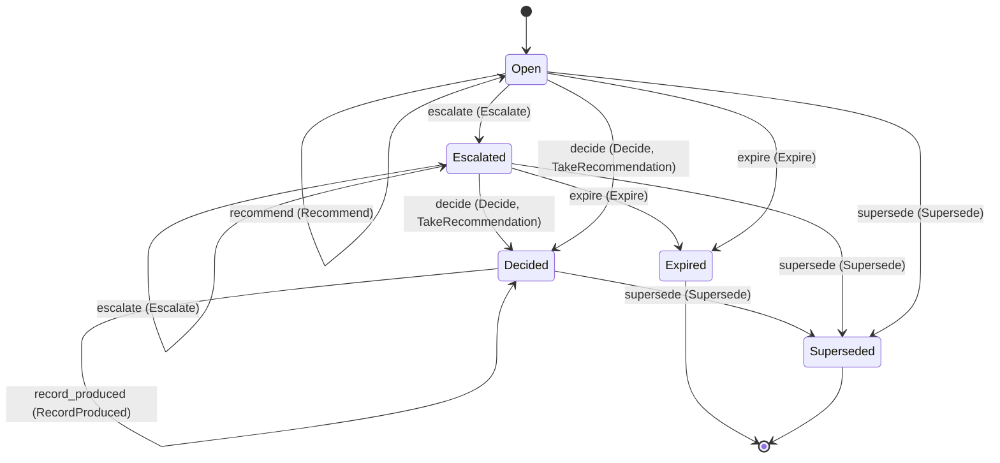

---
# generated by loom-docs, do not edit
title: "Decisions domain"
sidebar_label: "Decisions"
description: "ESS reference for the Decisions domain, generated from the specification."
custom_edit_url: null
---

<!-- generated by loom-docs, do not edit -->

# Decisions

Decision requests: every approval or decision the SDC asks of a person or a decider, with its options, a recommendation and the grounds it rests on. A decision request is opened where a case stops on a decision (driver verdicts awaiting_authority and awaiting_person, docs/driver.md:119-127), is decided by a principal allowed at its autonomy level, and once decided names the Canon record it produced (canon-authority/1, canon-decisions/1 or canon-evidence/1). docs/decisions.md explains it in plain terms.

`loom.decision` is one of loom's bounded contexts. [All domains](./index.mdx).

## Types

### `ActionId`

`loom.decision.ActionId` wraps `String` and is not interchangeable with one: the whole value of naming it separately is the crossings the model then refuses.

### `ArtifactId`

`loom.decision.ArtifactId` wraps `String` and is not interchangeable with one: the whole value of naming it separately is the crossings the model then refuses.

### `ArtifactRevisionCitation`

`loom.decision.ArtifactRevisionCitation` is a record of five fields:

- `artifact` — `loom.decision.ArtifactId`
- `revision` — `loom.decision.Revision`
- `case` — `Optional<loom.decision.CaseId>`, which may be absent
- `entry` — `Optional<String>`, which may be absent
- `digest` — `Optional<String>`, which may be absent

### `AutonomyLevel`

`loom.decision.AutonomyLevel` is one of `A0`, `A1`, `A2`, `A3`, `A4` and `A5`.

### `CapabilityId`

`loom.decision.CapabilityId` wraps `String` and is not interchangeable with one: the whole value of naming it separately is the crossings the model then refuses.

### `CaseId`

`loom.decision.CaseId` wraps `String` and is not interchangeable with one: the whole value of naming it separately is the crossings the model then refuses.

### `CheckVerdict`

`loom.decision.CheckVerdict` is one of `verified` and `refused`.

### `Citation`

`loom.decision.Citation` is one of three shapes, told apart by a `form` field — tagged, so a decoder never has to guess which branch it is reading:

- `artifact_revision` — `loom.decision.ArtifactRevisionCitation`
- `path_line` — `loom.decision.PathLineCitation`
- `record_id` — `loom.decision.RecordCitation`

### `Consequence`

`loom.decision.Consequence` is a record of five fields:

- `admits` — `List<loom.decision.ActionId>`
- `blocks` — `List<loom.decision.ActionId>`
- `grant` — `Optional<loom.decision.Grant>`, which may be absent
- `answer` — `Optional<String>`, which may be absent
- `produces` — `Optional<loom.decision.ProducedDocument>`, which may be absent

### `DecisionClassId`

`loom.decision.DecisionClassId` wraps `String` and is not interchangeable with one: the whole value of naming it separately is the crossings the model then refuses.

### `DecisionOption`

`loom.decision.DecisionOption` is a record of four fields:

- `letter` — `loom.decision.OptionLetter`
- `does` — `String`
- `cost` — `String`
- `consequence` — `loom.decision.Consequence`

### `DecisionRequestId`

`loom.decision.DecisionRequestId` wraps `String` and is not interchangeable with one: the whole value of naming it separately is the crossings the model then refuses.

### `EscalationSuppressedRecord`

`loom.decision.EscalationSuppressedRecord` is a record of eight fields:

- `request_id` — `loom.decision.DecisionRequestId`
- `decision_class` — `loom.decision.DecisionClassId`
- `subject_artifact` — `loom.decision.ArtifactId`
- `subject_revision` — `loom.decision.Revision`
- `reasons` — `List<String>`
- `best` — `Optional<loom.decision.OptionLetter>`, which may be absent
- `cause` — `loom.decision.SuppressionCause`
- `kept_at` — `Timestamp`

### `Grant`

`loom.decision.Grant` is one of `granted` and `denied`.

### `Ground`

`loom.decision.Ground` is a record of four fields:

- `source` — `loom.decision.GroundSource`
- `citation` — `loom.decision.Citation`
- `supports` — `Optional<loom.decision.OptionLetter>`, which may be absent
- `how` — `String`

### `GroundSource`

`loom.decision.GroundSource` is one of `idea`, `vision`, `requirement`, `prior_decision`, `prd`, `story`, `spec`, `policy`, `evidence_record`, `autonomy_rule` and `goals`.

### `Holder`

`loom.decision.Holder` is one of `person`, `advised`, `decider`, `decider_final`, `rule`, `rule_final`, `rule_and_decider` and `rule_and_decider_final`.

### `OptionLetter`

`loom.decision.OptionLetter` wraps `String` and is not interchangeable with one: the whole value of naming it separately is the crossings the model then refuses.

### `OutcomeId`

`loom.decision.OutcomeId` wraps `String` and is not interchangeable with one: the whole value of naming it separately is the crossings the model then refuses.

### `PathLineCitation`

`loom.decision.PathLineCitation` is a record of four fields:

- `path` — `String`
- `line` — `Integer`
- `line_end` — `Optional<Integer>`, which may be absent
- `digest` — `Optional<String>`, which may be absent

### `Principal`

`loom.decision.Principal` wraps `String` and is not interchangeable with one: the whole value of naming it separately is the crossings the model then refuses.

### `PrincipalKind`

`loom.decision.PrincipalKind` is one of `person`, `decider`, `rule` and `silence`.

### `ProducedDocument`

`loom.decision.ProducedDocument` is one of `canon_authority`, `canon_decisions`, `canon_evidence` and `artifact_revision`.

### `ProducedRecord`

`loom.decision.ProducedRecord` is a record of four fields:

- `document` — `loom.decision.ProducedDocument`
- `record` — `String`
- `case_revision` — `loom.decision.Revision`
- `aep_record` — `Optional<String>`, which may be absent

### `ProposerKind`

`loom.decision.ProposerKind` is one of `rule`, `llm`, `person` and `prior_decision`.

### `RecordCitation`

`loom.decision.RecordCitation` is a record of two fields:

- `store` — `loom.decision.RecordStore`
- `record_id` — `String`

### `RecordStore`

`loom.decision.RecordStore` is one of `sdc_decisions`, `canon_evidence`, `canon_authority`, `canon_decisions` and `aep_artifact`.

### `Revision`

`loom.decision.Revision` wraps `String` and is not interchangeable with one: the whole value of naming it separately is the crossings the model then refuses.

### `Strength`

`loom.decision.Strength` is one of `none`, `weak`, `moderate` and `strong`.

### `SuppressionCause`

`loom.decision.SuppressionCause` is one of `escalate`, `failure`, `withheld`, `veto` and `rule_escalate`.

### `UnblockKind`

`loom.decision.UnblockKind` is one of `approval`, `question` and `outcome`.

### `Unblocks`

`loom.decision.Unblocks` is a record of five fields:

- `kind` — `loom.decision.UnblockKind`
- `action` — `loom.decision.ActionId`
- `capability` — `Optional<loom.decision.CapabilityId>`, which may be absent
- `question_id` — `Optional<String>`, which may be absent
- `outcome` — `Optional<loom.decision.OutcomeId>`, which may be absent

## Entities

An entity is what this context is about: something with an identity that outlives any one request, a shape, and a lifecycle. The lifecycle is exhaustive — a move that is not drawn below is a move this specification does not permit, and that is the only way it says so. Every move is labelled with the command that takes it, because a move nothing can trigger is refused rather than drawn.

### `DecisionRequest`

`loom.decision.DecisionRequest`.

An instance is identified by `request_id`, a `loom.decision.DecisionRequestId`. The name is part of the model and not a convention: a view projects the identity under that name, so a projection inventing its own would disagree with the view.

It holds:

- `case_id` — `loom.decision.CaseId`
- `question_key` — `String`
- `record_key` — `String`
- `unblocks` — `loom.decision.Unblocks`
- `subject_artifact` — `loom.decision.ArtifactId`
- `subject_revision` — `loom.decision.Revision`
- `subject_path` — `Optional<String>`, which may be absent
- `question` — `String`
- `options` — `List<loom.decision.DecisionOption>`
- `autonomy_level` — `loom.decision.AutonomyLevel`
- `decision_class` — `loom.decision.DecisionClassId`
- `holder` — `loom.decision.Holder`
- `eligible` — `List<loom.decision.Principal>`
- `addressed_to` — `loom.decision.Principal`
- `opened_at` — `Timestamp`
- `expires_at` — `Optional<Timestamp>`, which may be absent
- `supersedes` — `Optional<loom.decision.DecisionRequestId>`, which may be absent
- `recommended_option` — `Optional<loom.decision.OptionLetter>`, which may be absent
- `recommended_answer` — `Optional<String>`, which may be absent
- `recommendation_strength` — `loom.decision.Strength`
- `default_on_silence` — `Boolean`
- `grounds` — `List<loom.decision.Ground>`
- `recommended_by` — `Optional<loom.decision.ProposerKind>`, which may be absent
- `grounding_report` — `Optional<String>`, which may be absent
- `no_recommendation_reason` — `Optional<String>`, which may be absent
- `escalated_to` — `Optional<loom.decision.Principal>`, which may be absent
- `escalation_reason` — `Optional<String>`, which may be absent
- `decided_option` — `Optional<loom.decision.OptionLetter>`, which may be absent
- `decided_answer` — `Optional<String>`, which may be absent
- `decided_by` — `Optional<loom.decision.Principal>`, which may be absent
- `decided_by_kind` — `Optional<loom.decision.PrincipalKind>`, which may be absent
- `decided_at` — `Optional<Timestamp>`, which may be absent
- `decided_case_revision` — `Optional<loom.decision.Revision>`, which may be absent
- `decision_reasons` — `List<String>`
- `produced_record` — `Optional<loom.decision.ProducedRecord>`, which may be absent
- `superseded_by` — `Optional<loom.decision.DecisionRequestId>`, which may be absent
- `superseded_reason` — `Optional<String>`, which may be absent

It references at most one [`DecisionRequest`](#decisionrequest), as `superseded_request`, carried by `DecisionRequest.supersedes`. It references at most one [`DecisionRequest`](#decisionrequest), as `superseding_request`, carried by `DecisionRequest.superseded_by`.

Every instance satisfies `(not (defined(recommended_option)) or not (defined(no_recommendation_reason)))`, `(not (defined(recommended_answer)) or not (defined(no_recommendation_reason)))` and `(default_on_silence == false or recommendation_strength == strong)` — a predicate over this entity's own fields, checked against them rather than stored as a sentence, so an invariant reading something the entity does not have is refused instead of documented.

Its state is a `loom.decision.DecisionRequest.State`, one of `Decided`, `Escalated`, `Expired`, `Open` and `Superseded`. That enum is synthesised from the lifecycle rather than declared beside it, so the states a view's filter compares and the states drawn below cannot disagree.

An instance is created in `Open`. `Expired` and `Superseded` are terminal, so an instance may rest there forever. That is declared rather than inferred from having no way out: an entity that cannot leave a state is either finished or stuck, and only its author knows which.

Each move is taken by a declared command outcome, and a move nothing takes is refused as `missing_causation` rather than left as a state change nobody can trigger:

- `recommend` — taken by `loom.decision.Recommend` on its `withheld` outcome and `loom.decision.Recommend` on its `recommended` outcome
- `escalate` — taken by `loom.decision.Escalate` on its `escalated` outcome
- `decide` — taken by `loom.decision.Decide` on its `decided` outcome and `loom.decision.TakeRecommendation` on its `taken` outcome
- `record_produced` — taken by `loom.decision.RecordProduced` on its `recorded` outcome
- `supersede` — taken by `loom.decision.Supersede` on its `superseded` outcome
- `expire` — taken by `loom.decision.Expire` on its `expired` outcome

An instance is brought into existence by `loom.decision.Request` on its `requested` outcome.

Illegal transitions are illegal by absence: no rule forbids them, there is simply no arrow, because a rule would be a second place for the same truth to live. A diagram cannot show an absence, so the pairs it does not connect are listed here, derived from the same transitions — anything named below is a move this specification does not permit.

- `Decided` may not become `Escalated`
- `Decided` may not become `Expired`
- `Decided` may not become `Open`
- `Escalated` may not become `Open`
- `Expired` may not become `Decided`
- `Expired` may not become `Escalated`
- `Expired` may not become `Open`
- `Expired` may not become `Superseded`
- `Superseded` may not become `Decided`
- `Superseded` may not become `Escalated`
- `Superseded` may not become `Expired`
- `Superseded` may not become `Open`

Three views project it: [`ArtifactDecisionHistory`](#artifactdecisionhistory), [`DecisionRequests`](#decisionrequests) and [`OpenDecisionsForPrincipal`](#opendecisionsforprincipal).

## Views

A view is what the outside world is promised it can observe. Each one says which instances it contains and how soon it reflects a command that has already returned, because "you can read this" without "how soon" is the promise every flaky suite is built on.

### `ArtifactDecisionHistory`

`loom.decision.ArtifactDecisionHistory`, shown to a person as "Decision history of an artifact" and called `artifact-history` on the wire.

It reads [`DecisionRequest`](#decisionrequest).

It contains the instances where `subject_artifact == param.artifact` holds, and only those — so an instance a caller cannot find in here has been filtered out rather than lost.

It exposes:

- `request_id` — `loom.decision.DecisionRequestId`
- `subject_revision` — `loom.decision.Revision`
- `question` — `String`
- `state` — `loom.decision.DecisionRequest.State`
- `decided_option` — `Optional<loom.decision.OptionLetter>`, which may be absent
- `decided_answer` — `Optional<String>`, which may be absent
- `decided_by` — `Optional<loom.decision.Principal>`, which may be absent
- `decided_at` — `Optional<Timestamp>`, which may be absent
- `produced_record` — `Optional<loom.decision.ProducedRecord>`, which may be absent
- `supersedes` — `Optional<loom.decision.DecisionRequestId>`, which may be absent
- `superseded_by` — `Optional<loom.decision.DecisionRequestId>`, which may be absent

It declares no order, so the rows come back in whatever order the implementation has, and two reads may disagree.

**Read-your-writes**: it is current the moment the command that changed it returns. A caller that has just created an invoice and cannot see it in here has been told a lie about what it did.

A generated scenario asserts it once, immediately after the command: a view promising this and not keeping the promise has to fail the suite rather than be retried until it passes.

### `DecisionRequests`

`loom.decision.DecisionRequests`, shown to a person as "Decision requests" and called `requests` on the wire.

It reads [`DecisionRequest`](#decisionrequest).

It contains every instance of that entity: no filter narrows it, which is a decision somebody made and not a line somebody omitted.

It exposes:

- `request_id` — `loom.decision.DecisionRequestId`
- `state` — `loom.decision.DecisionRequest.State`
- `case_id` — `loom.decision.CaseId`
- `question_key` — `String`
- `record_key` — `String`
- `unblocks` — `loom.decision.Unblocks`
- `subject_artifact` — `loom.decision.ArtifactId`
- `subject_revision` — `loom.decision.Revision`
- `subject_path` — `Optional<String>`, which may be absent
- `question` — `String`
- `options` — `List<loom.decision.DecisionOption>`
- `autonomy_level` — `loom.decision.AutonomyLevel`
- `decision_class` — `loom.decision.DecisionClassId`
- `holder` — `loom.decision.Holder`
- `eligible` — `List<loom.decision.Principal>`
- `addressed_to` — `loom.decision.Principal`
- `opened_at` — `Timestamp`
- `expires_at` — `Optional<Timestamp>`, which may be absent
- `supersedes` — `Optional<loom.decision.DecisionRequestId>`, which may be absent
- `recommended_option` — `Optional<loom.decision.OptionLetter>`, which may be absent
- `recommended_answer` — `Optional<String>`, which may be absent
- `recommendation_strength` — `loom.decision.Strength`
- `default_on_silence` — `Boolean`
- `grounds` — `List<loom.decision.Ground>`
- `recommended_by` — `Optional<loom.decision.ProposerKind>`, which may be absent
- `grounding_report` — `Optional<String>`, which may be absent
- `no_recommendation_reason` — `Optional<String>`, which may be absent
- `escalated_to` — `Optional<loom.decision.Principal>`, which may be absent
- `escalation_reason` — `Optional<String>`, which may be absent
- `decided_option` — `Optional<loom.decision.OptionLetter>`, which may be absent
- `decided_answer` — `Optional<String>`, which may be absent
- `decided_by` — `Optional<loom.decision.Principal>`, which may be absent
- `decided_by_kind` — `Optional<loom.decision.PrincipalKind>`, which may be absent
- `decided_at` — `Optional<Timestamp>`, which may be absent
- `decided_case_revision` — `Optional<loom.decision.Revision>`, which may be absent
- `decision_reasons` — `List<String>`
- `produced_record` — `Optional<loom.decision.ProducedRecord>`, which may be absent
- `superseded_by` — `Optional<loom.decision.DecisionRequestId>`, which may be absent
- `superseded_reason` — `Optional<String>`, which may be absent

It declares no order, so the rows come back in whatever order the implementation has, and two reads may disagree.

**Read-your-writes**: it is current the moment the command that changed it returns. A caller that has just created an invoice and cannot see it in here has been told a lie about what it did.

A generated scenario asserts it once, immediately after the command: a view promising this and not keeping the promise has to fail the suite rather than be retried until it passes.

### `OpenDecisionsForPrincipal`

`loom.decision.OpenDecisionsForPrincipal`, shown to a person as "Open decisions for a principal" and called `open-for-principal` on the wire.

It reads [`DecisionRequest`](#decisionrequest).

It contains the instances where `((state == Open or state == Escalated) and addressed_to == param.principal)` holds, and only those — so an instance a caller cannot find in here has been filtered out rather than lost.

It exposes:

- `request_id` — `loom.decision.DecisionRequestId`
- `case_id` — `loom.decision.CaseId`
- `question` — `String`
- `subject_artifact` — `loom.decision.ArtifactId`
- `subject_revision` — `loom.decision.Revision`
- `recommended_option` — `Optional<loom.decision.OptionLetter>`, which may be absent
- `recommended_answer` — `Optional<String>`, which may be absent
- `recommendation_strength` — `loom.decision.Strength`
- `no_recommendation_reason` — `Optional<String>`, which may be absent
- `opened_at` — `Timestamp`
- `expires_at` — `Optional<Timestamp>`, which may be absent

It declares no order, so the rows come back in whatever order the implementation has, and two reads may disagree.

**Read-your-writes**: it is current the moment the command that changed it returns. A caller that has just created an invoice and cannot see it in here has been told a lie about what it did.

A generated scenario asserts it once, immediately after the command: a view promising this and not keeping the promise has to fail the suite rather than be retried until it passes.

## Commands

### `Decide`

`loom.decision.Decide`, shown to a person as "Decide" and called `decide` on the wire.

It takes:

- `request_id` — `loom.decision.DecisionRequestId`
- `option` — `Optional<loom.decision.OptionLetter>`, which may be absent
- `answer` — `Optional<String>`, which may be absent
- `principal` — `loom.decision.Principal`
- `principal_kind` — `loom.decision.PrincipalKind`
- `decided_at` — `Timestamp`
- `case_revision` — `loom.decision.Revision`
- `reasons` — `List<String>`

It has 11 outcomes.

**`kind-not-principal`** — principal_kind must be the kind the principal's name has: decider:<kind> is decider, rule:<name> is rule, silence is silence, any other name is person. A command whose kind is not its principal's is refused whatever the holder, before every other kind guard. Taken when `((principal_kind == decider and not (principal starts_with "decider:")) or (principal_kind == rule and not (principal starts_with "rule:")) or (principal_kind == silence and principal != silence) or (principal_kind == person and (principal starts_with "decider:" or principal starts_with "rule:" or principal == silence)))` holds of the input. No entity in this specification changes. It reports `loom.decision.NotEligible`, carrying `request_id` and `principal`. It emits nothing. A test reaches it by constructing an input that satisfies that condition.

**`silence-takes-recommendation`** — Silence never chooses an option: a default on silence is taken through TakeRecommendation. Taken when `principal_kind == silence` holds of the input. No entity in this specification changes. It reports `loom.decision.NotEligible`, carrying `request_id` and `principal`. It emits nothing. A test reaches it by constructing an input that satisfies that condition.

**`option-or-answer`** — A decision names exactly one of an option and a free answer. Taken when `((defined(option) and defined(answer)) or (not (defined(option)) and not (defined(answer))))` holds of the input. No entity in this specification changes. It reports `loom.decision.OptionOrAnswer`, carrying `request_id`. It emits nothing. A test reaches it by constructing an input that satisfies that condition.

**`no-request`** — No request has this id. Taken when the identity the command names is one no record carries, before any other answer for it. No entity in this specification changes. It reports `loom.decision.NoSuchRequest`, carrying `request_id`. It emits nothing. A test reaches it by sending an identity no record carries, arranging nothing.

**`answer-not-allowed`** — An approval or an outcome is decided by one of its options; only a question request takes a free answer. Taken when the existing subject's stored fields satisfy `unblocks.kind != question`, and `defined(answer)` holds of the input. No entity in this specification changes. It reports `loom.decision.AnswerNotAllowed`, carrying `request_id`. It emits nothing. A test establishes and independently observes the subject enum fact before selecting this branch.

**`person-only`** — Holder P or P+ (docs/autonomy-levels.md:233-234): only a person decides; at P+ the decider's proposal is the recommendation (propose only). Taken when the existing subject's stored fields satisfy `(holder == person or holder == advised)`, and `principal_kind != person` holds of the input. No entity in this specification changes. It reports `loom.decision.NotEligible`, carrying `request_id` and `principal`. It emits nothing. A test establishes and independently observes the subject enum fact before selecting this branch.

**`not-listed`** — The principal is not in the request's eligible list. Taken when the existing subject's stored fields satisfy `not (exists p in eligible: (p == input.principal))`. No entity in this specification changes. It reports `loom.decision.NotEligible`, carrying `request_id` and `principal`. It emits nothing. A test establishes and independently observes the subject enum fact before selecting this branch.

**`decider-under-rule`** — Holder R, R: end or R∧D (docs/autonomy-levels.md:237-239): the decider does not choose an option and never grants against the rule. Under R∧D→P (rule_and_decider) it takes the rule's recommendation through TakeRecommendation or vetoes through Escalate. Under R∧D* (rule_and_decider_final) its veto is a Decide on the denying option (consequence.grant denied) and nothing else; the run then ends as refused, with no explicitly_abandoned record (:275-276). Taken when the existing subject's stored fields satisfy `(holder == rule or holder == rule_final or holder == rule_and_decider or (holder == rule_and_decider_final and not (exists o in options: ((o.letter == input.option and o.consequence.grant == denied)))))`, and `principal_kind == decider` holds of the input. No entity in this specification changes. It reports `loom.decision.NotEligible`, carrying `request_id` and `principal`. It emits nothing. A test establishes and independently observes the subject enum fact before selecting this branch.

**`rule-not-holder`** — A rule decides alone only where the holder is R or R: end (docs/autonomy-levels.md:237-238). Taken when the existing subject's stored fields satisfy `not ((holder == rule or holder == rule_final))`, and `principal_kind == rule` holds of the input. No entity in this specification changes. It reports `loom.decision.NotEligible`, carrying `request_id` and `principal`. It emits nothing. A test establishes and independently observes the subject enum fact before selecting this branch.

**`decided`** — The request is Decided and has no produced_record yet; RecordProduced adds it after the runtime wrote the Canon record. The default branch, taken when no other outcome's condition matched. It moves a `loom.decision.DecisionRequest` from `Escalated` and `Open` to `Decided`, along the declared move `decide`. The instance is the one named by the input field `request_id`. It emits `loom.decision.DecisionTaken`. It sets `decided_option` from `input.option`, `decided_answer` from `input.answer`, `decided_by` from `input.principal`, `decided_by_kind` from `input.principal_kind`, `decided_at` from `input.decided_at`, `decided_case_revision` from `input.case_revision` and `decision_reasons` from `input.reasons`. A test reaches it by constructing an input that satisfies no other outcome's condition.

**`wrong-state`** — The request is not Open or Escalated. Taken when the subject is resting in a state none of this command's moves start from — a `loom.decision.DecisionRequest` in `Decided`, `Expired` and `Superseded`, which is what is left of the lifecycle once this command's own moves are taken away. The document lists none of it. No entity in this specification changes. It reports `loom.decision.DecisionStateConflict`, carrying `request_id`. It emits nothing. A test reaches it by driving an instance into one of those states and then issuing the command, because no input selects this branch.

### `Escalate`

`loom.decision.Escalate`, shown to a person as "Escalate" and called `escalate` on the wire.

It takes:

- `request_id` — `loom.decision.DecisionRequestId`
- `escalate_to` — `loom.decision.Principal`
- `reason` — `String`

It has four outcomes.

**`no-request`** — No request has this id. Taken when the identity the command names is one no record carries, before any other answer for it. No entity in this specification changes. It reports `loom.decision.NoSuchRequest`, carrying `request_id`. It emits nothing. A test reaches it by sending an identity no record carries, arranging nothing.

**`suppressed`** — Holder D*, R: end or R∧D* (A5, docs/autonomy-levels.md:236, :255-256, :385, :454-459): no person is asked. Under D* the decider's best is taken through Decide or TakeRecommendation and the driver records escalation_suppressed; under R: end and on an R∧D* veto the run ends. Taken when the existing subject's stored fields satisfy `(holder == decider_final or holder == rule_final or holder == rule_and_decider_final)`. No entity in this specification changes. It reports `loom.decision.EscalationSuppressed`, carrying `request_id`. It emits nothing. A test establishes and independently observes the subject enum fact before selecting this branch.

**`escalated`** — The request waits on the named person and its holder becomes P, the escalation row's cell, so a decider can no longer decide it. A P+ request passed on by a person also becomes P: P and P+ have the same guards, and the recommendation stays. The default branch, taken when no other outcome's condition matched. It moves a `loom.decision.DecisionRequest` from `Escalated` and `Open` to `Escalated`, along the declared move `escalate`. The instance is the one named by the input field `request_id`. It emits `loom.decision.DecisionEscalated`. It sets `holder` from `"person"`, `addressed_to` from `input.escalate_to`, `escalated_to` from `input.escalate_to` and `escalation_reason` from `input.reason`. A test reaches it by constructing an input that satisfies no other outcome's condition.

**`wrong-state`** — The request is not Open or Escalated. Taken when the subject is resting in a state none of this command's moves start from — a `loom.decision.DecisionRequest` in `Decided`, `Expired` and `Superseded`, which is what is left of the lifecycle once this command's own moves are taken away. The document lists none of it. No entity in this specification changes. It reports `loom.decision.DecisionStateConflict`, carrying `request_id`. It emits nothing. A test reaches it by driving an instance into one of those states and then issuing the command, because no input selects this branch.

### `Expire`

`loom.decision.Expire`, shown to a person as "Expire" and called `expire` on the wire.

It takes:

- `request_id` — `loom.decision.DecisionRequestId`
- `at` — `Timestamp`

It has five outcomes.

**`no-request`** — No request has this id. Taken when the identity the command names is one no record carries, before any other answer for it. No entity in this specification changes. It reports `loom.decision.NoSuchRequest`, carrying `request_id`. It emits nothing. A test reaches it by sending an identity no record carries, arranging nothing.

**`not-due`** — The request has no expires_at, or the tick's instant is before it. Taken when the existing subject's stored fields satisfy `(not (defined(expires_at)) or expires_at > input.at as timestamp)`. No entity in this specification changes. It reports `loom.decision.NotDue`, carrying `request_id`. It emits nothing. A test establishes and independently observes the subject enum fact before selecting this branch.

**`has-default`** — Decide it with principal silence instead. Taken when the existing subject's stored fields satisfy `default_on_silence == true`. No entity in this specification changes. It reports `loom.decision.SilenceHasDefault`, carrying `request_id`. It emits nothing. A test establishes and independently observes the subject enum fact before selecting this branch.

**`expired`** — The request is Expired; the case stays stopped. The default branch, taken when no other outcome's condition matched. It moves a `loom.decision.DecisionRequest` from `Escalated` and `Open` to `Expired`, along the declared move `expire`. The instance is the one named by the input field `request_id`. It emits `loom.decision.DecisionExpired`. A test reaches it by constructing an input that satisfies no other outcome's condition.

**`wrong-state`** — The request is not Open or Escalated. Taken when the subject is resting in a state none of this command's moves start from — a `loom.decision.DecisionRequest` in `Decided`, `Expired` and `Superseded`, which is what is left of the lifecycle once this command's own moves are taken away. The document lists none of it. No entity in this specification changes. It reports `loom.decision.DecisionStateConflict`, carrying `request_id`. It emits nothing. A test reaches it by driving an instance into one of those states and then issuing the command, because no input selects this branch.

### `Recommend`

`loom.decision.Recommend`, shown to a person as "Record a recommendation" and called `recommend` on the wire.

It takes:

- `request_id` — `loom.decision.DecisionRequestId`
- `recommended_option` — `Optional<loom.decision.OptionLetter>`, which may be absent
- `recommended_answer` — `Optional<String>`, which may be absent
- `strength` — `loom.decision.Strength`
- `default_on_silence` — `Boolean`
- `grounds` — `List<loom.decision.Ground>`
- `proposed_by` — `loom.decision.ProposerKind`
- `check_verdict` — `loom.decision.CheckVerdict`
- `check_report` — `String`

It has eight outcomes.

**`ungrounded`** — A verified recommendation without a ground, or with strength none, is a contradiction: nothing was recorded. Taken when `(check_verdict == verified and (grounds.count < 1 or strength == none))` holds of the input. No entity in this specification changes. It reports `loom.decision.UngroundedRecommendation`, carrying `request_id`. It emits nothing. A test reaches it by constructing an input that satisfies that condition.

**`silence-needs-strong`** — Only a strong recommendation may be the default on silence. Taken when `(check_verdict == verified and default_on_silence == true and strength != strong)` holds of the input. No entity in this specification changes. It reports `loom.decision.NoDefaultOnSilence`, carrying `request_id`. It emits nothing. A test reaches it by constructing an input that satisfies that condition.

**`option-or-answer`** — A verified recommendation names exactly one of an option and a free answer. Taken when `(check_verdict == verified and ((defined(recommended_option) and defined(recommended_answer)) or (not (defined(recommended_option)) and not (defined(recommended_answer)))))` holds of the input. No entity in this specification changes. It reports `loom.decision.OptionOrAnswer`, carrying `request_id`. It emits nothing. A test reaches it by constructing an input that satisfies that condition.

**`no-request`** — No request has this id. Taken when the identity the command names is one no record carries, before any other answer for it. No entity in this specification changes. It reports `loom.decision.NoSuchRequest`, carrying `request_id`. It emits nothing. A test reaches it by sending an identity no record carries, arranging nothing.

**`answer-not-allowed`** — Only a question request is recommended a free answer. Taken when the existing subject's stored fields satisfy `unblocks.kind != question`, and `(check_verdict == verified and defined(recommended_answer))` holds of the input. No entity in this specification changes. It reports `loom.decision.AnswerNotAllowed`, carrying `request_id`. It emits nothing. A test establishes and independently observes the subject enum fact before selecting this branch.

**`withheld`** — The check refused the citations: the request carries no recommendation and says why. Taken when `check_verdict == refused` holds of the input. It moves a `loom.decision.DecisionRequest` from `Open` to `Open`, along the declared move `recommend`. The instance is the one named by the input field `request_id`. It emits `loom.decision.RecommendationWithheld`. It sets `recommended_option` cleared, `recommended_answer` cleared, `recommendation_strength` from `"none"`, `default_on_silence` from `"false"`, `grounds` set to the empty list `[]`, `recommended_by` cleared, `grounding_report` cleared and `no_recommendation_reason` from `input.check_report`. A test reaches it by constructing an input that satisfies that condition.

**`recommended`** — The request carries the recommendation and its verified grounds. The default branch, taken when no other outcome's condition matched. It moves a `loom.decision.DecisionRequest` from `Open` to `Open`, along the declared move `recommend`. The instance is the one named by the input field `request_id`. It emits `loom.decision.RecommendationRecorded`. It sets `recommended_option` from `input.recommended_option`, `recommended_answer` from `input.recommended_answer`, `recommendation_strength` from `input.strength`, `default_on_silence` from `input.default_on_silence`, `grounds` from `input.grounds`, `recommended_by` from `input.proposed_by`, `grounding_report` from `input.check_report` and `no_recommendation_reason` cleared. A test reaches it by constructing an input that satisfies no other outcome's condition.

**`wrong-state`** — The request is not Open. Taken when the subject is resting in a state none of this command's moves start from — a `loom.decision.DecisionRequest` in `Decided`, `Escalated`, `Expired` and `Superseded`, which is what is left of the lifecycle once this command's own moves are taken away. The document lists none of it. No entity in this specification changes. It reports `loom.decision.DecisionStateConflict`, carrying `request_id`. It emits nothing. A test reaches it by driving an instance into one of those states and then issuing the command, because no input selects this branch.

### `RecordProduced`

`loom.decision.RecordProduced`, shown to a person as "Record the produced Canon record" and called `record-produced` on the wire.

It takes:

- `request_id` — `loom.decision.DecisionRequestId`
- `produced` — `loom.decision.ProducedRecord`

It has six outcomes.

**`no-request`** — No request has this id. Taken when the identity the command names is one no record carries, before any other answer for it. No entity in this specification changes. It reports `loom.decision.NoSuchRequest`, carrying `request_id`. It emits nothing. A test reaches it by sending an identity no record carries, arranging nothing.

**`already-recorded`** — A record with the same record id is already stored: record ids key idempotence, so a retry after the record was written changes nothing. Taken when the existing subject's stored fields satisfy `{expr: "coalesce(produced_record.record, "")"} == input.produced.record`. It preserves the existing subject, without an error or event. The instance is the one named by the input field `request_id`. It emits nothing. A test establishes and independently observes the subject enum fact before selecting this branch.

**`produced-conflict`** — A different record is already stored: the first one stands. Taken when the existing subject's stored fields satisfy `defined(produced_record)`. No entity in this specification changes. It reports `loom.decision.ProducedRecordConflict`, carrying `request_id`. It emits nothing. A test establishes and independently observes the subject enum fact before selecting this branch.

**`option-produces-none`** — The decided option produces no Canon record: the run resumes or ends without RecordProduced. Taken when the existing subject's stored fields satisfy `(defined(decided_option) and not (exists o in options: ((o.letter == {fact: decided_option} and defined(o.consequence.produces)))))`. No entity in this specification changes. It reports `loom.decision.NoRecordToProduce`, carrying `request_id`. It emits nothing. A test establishes and independently observes the subject enum fact before selecting this branch.

**`recorded`** — The Decided request names the Canon record it produced; the run may resume. The default branch, taken when no other outcome's condition matched. It moves a `loom.decision.DecisionRequest` from `Decided` to `Decided`, along the declared move `record_produced`. The instance is the one named by the input field `request_id`. It emits `loom.decision.ProducedRecordRecorded`. It sets `produced_record` from `input.produced`. A test reaches it by constructing an input that satisfies no other outcome's condition.

**`wrong-state`** — The request is not Decided. Taken when the subject is resting in a state none of this command's moves start from — a `loom.decision.DecisionRequest` in `Escalated`, `Expired`, `Open` and `Superseded`, which is what is left of the lifecycle once this command's own moves are taken away. The document lists none of it. No entity in this specification changes. It reports `loom.decision.DecisionStateConflict`, carrying `request_id`. It emits nothing. A test reaches it by driving an instance into one of those states and then issuing the command, because no input selects this branch.

### `Request`

`loom.decision.Request`, shown to a person as "Request a decision" and called `request` on the wire.

It takes:

- `request_id` — `loom.decision.DecisionRequestId`
- `case_id` — `loom.decision.CaseId`
- `question_key` — `String`
- `record_key` — `String`
- `open_for_record` — `Optional<loom.decision.DecisionRequestId>`, which may be absent
- `unblocks` — `loom.decision.Unblocks`
- `subject_artifact` — `loom.decision.ArtifactId`
- `subject_revision` — `loom.decision.Revision`
- `subject_path` — `Optional<String>`, which may be absent
- `question` — `String`
- `options` — `List<loom.decision.DecisionOption>`
- `autonomy_level` — `loom.decision.AutonomyLevel`
- `decision_class` — `loom.decision.DecisionClassId`
- `holder` — `loom.decision.Holder`
- `eligible` — `List<loom.decision.Principal>`
- `addressed_to` — `loom.decision.Principal`
- `opened_at` — `Timestamp`
- `expires_at` — `Optional<Timestamp>`, which may be absent
- `supersedes` — `Optional<loom.decision.DecisionRequestId>`, which may be absent

It has four outcomes.

**`escalation-is-not-a-class`** — The escalation row of docs/autonomy-levels.md:257 is not a request class: Escalate moves an existing request, and the row gives its holder after Escalate. Nothing was opened. Taken when `decision_class == escalation` holds of the input. No entity in this specification changes. It reports `loom.decision.NotARequestClass`, carrying `request_id`. It emits nothing. A test reaches it by constructing an input that satisfies that condition.

**`too-few-options`** — Fewer than two options: nothing was opened. Taken when `options.count < 2` holds of the input. No entity in this specification changes. It reports `loom.decision.TooFewOptions`, carrying `request_id`. It emits nothing. A test reaches it by constructing an input that satisfies that condition.

**`record-key-open`** — An Open or Escalated request exists for the record key, the one named: nothing was opened (refusal, not supersession). Taken when `defined(open_for_record)` holds of the input. No entity in this specification changes. It reports `loom.decision.RecordKeyOpen`, carrying `request_id` and `open_for_record`. It emits nothing. A test reaches it by constructing an input that satisfies that condition.

**`requested`** — The request is Open, with no recommendation yet. The default branch, taken when no other outcome's condition matched. It creates a `loom.decision.DecisionRequest`, which starts in `Open`. The new instance's identity is published as `request_id` on `loom.decision.DecisionRequested`. It emits `loom.decision.DecisionRequested`. It sets `case_id` from `input.case_id`, `question_key` from `input.question_key`, `record_key` from `input.record_key`, `unblocks` from `input.unblocks`, `subject_artifact` from `input.subject_artifact`, `subject_revision` from `input.subject_revision`, `subject_path` from `input.subject_path`, `question` from `input.question`, `options` from `input.options`, `autonomy_level` from `input.autonomy_level`, `decision_class` from `input.decision_class`, `holder` from `input.holder`, `eligible` from `input.eligible`, `addressed_to` from `input.addressed_to`, `opened_at` from `input.opened_at`, `expires_at` from `input.expires_at`, `supersedes` from `input.supersedes`, `recommendation_strength` from `"none"`, `default_on_silence` from `"false"`, `grounds` set to the empty list `[]` and `decision_reasons` set to the empty list `[]`. A test reaches it by constructing an input that satisfies no other outcome's condition.

### `Supersede`

`loom.decision.Supersede`, shown to a person as "Supersede" and called `supersede` on the wire.

It takes:

- `request_id` — `loom.decision.DecisionRequestId`
- `superseded_by` — `loom.decision.DecisionRequestId`
- `reason` — `String`

It has three outcomes.

**`no-request`** — No request has this id. Taken when the identity the command names is one no record carries, before any other answer for it. No entity in this specification changes. It reports `loom.decision.NoSuchRequest`, carrying `request_id`. It emits nothing. A test reaches it by sending an identity no record carries, arranging nothing.

**`superseded`** — The request is Superseded; a decision it held no longer applies. Superseding a Decided request does not revoke the Canon record it produced: Canon's own binding to the subject or case revision decides whether that record still applies. The default branch, taken when no other outcome's condition matched. It moves a `loom.decision.DecisionRequest` from `Decided`, `Escalated` and `Open` to `Superseded`, along the declared move `supersede`. The instance is the one named by the input field `request_id`. It emits `loom.decision.DecisionSuperseded`. It sets `superseded_by` from `input.superseded_by` and `superseded_reason` from `input.reason`. A test reaches it by constructing an input that satisfies no other outcome's condition.

**`wrong-state`** — The request is already Superseded or Expired. Taken when the subject is resting in a state none of this command's moves start from — a `loom.decision.DecisionRequest` in `Expired` and `Superseded`, which is what is left of the lifecycle once this command's own moves are taken away. The document lists none of it. No entity in this specification changes. It reports `loom.decision.DecisionStateConflict`, carrying `request_id`. It emits nothing. A test reaches it by driving an instance into one of those states and then issuing the command, because no input selects this branch.

### `TakeRecommendation`

`loom.decision.TakeRecommendation`, shown to a person as "Take the recommendation" and called `take-recommendation` on the wire.

It takes:

- `request_id` — `loom.decision.DecisionRequestId`
- `principal` — `loom.decision.Principal`
- `principal_kind` — `loom.decision.PrincipalKind`
- `decided_at` — `Timestamp`
- `case_revision` — `loom.decision.Revision`
- `reasons` — `List<String>`

It has nine outcomes.

**`kind-not-principal`** — principal_kind must be the kind the principal's name has: decider:<kind> is decider, rule:<name> is rule, silence is silence, any other name is person. A command whose kind is not its principal's is refused whatever the holder, before every other kind guard. Taken when `((principal_kind == decider and not (principal starts_with "decider:")) or (principal_kind == rule and not (principal starts_with "rule:")) or (principal_kind == silence and principal != silence) or (principal_kind == person and (principal starts_with "decider:" or principal starts_with "rule:" or principal == silence)))` holds of the input. No entity in this specification changes. It reports `loom.decision.NotEligible`, carrying `request_id` and `principal`. It emits nothing. A test reaches it by constructing an input that satisfies that condition.

**`no-request`** — No request has this id. Taken when the identity the command names is one no record carries, before any other answer for it. No entity in this specification changes. It reports `loom.decision.NoSuchRequest`, carrying `request_id`. It emits nothing. A test reaches it by sending an identity no record carries, arranging nothing.

**`person-only`** — Holder P or P+: only a person decides, a recommendation included. Taken when the existing subject's stored fields satisfy `(holder == person or holder == advised)`, and `(principal_kind == decider or principal_kind == rule)` holds of the input. No entity in this specification changes. It reports `loom.decision.NotEligible`, carrying `request_id` and `principal`. It emits nothing. A test establishes and independently observes the subject enum fact before selecting this branch.

**`not-listed`** — A person or decider not in the request's eligible list. Taken when the existing subject's stored fields satisfy `not (exists p in eligible: (p == input.principal))`, and `principal_kind != silence` holds of the input. No entity in this specification changes. It reports `loom.decision.NotEligible`, carrying `request_id` and `principal`. It emits nothing. A test establishes and independently observes the subject enum fact before selecting this branch.

**`not-strong`** — Only a strong recommendation is taken through TakeRecommendation, by every principal kind. A person who wants a weak or moderate recommendation chooses its option through Decide. An absent recommendation has strength none. Taken when the existing subject's stored fields satisfy `recommendation_strength != strong`. No entity in this specification changes. It reports `loom.decision.NotEligible`, carrying `request_id` and `principal`. It emits nothing. A test establishes and independently observes the subject enum fact before selecting this branch.

**`silence-without-default`** — Silence takes the recommendation only when it is the default on silence. Taken when the existing subject's stored fields satisfy `default_on_silence == false`, and `principal_kind == silence` holds of the input. No entity in this specification changes. It reports `loom.decision.NoDefaultOnSilence`, carrying `request_id`. It emits nothing. A test establishes and independently observes the subject enum fact before selecting this branch.

**`silence-not-due`** — Silence is fired by a host tick at or after expires_at; the tick's instant is decided_at. Taken when the existing subject's stored fields satisfy `(not (defined(expires_at)) or expires_at > input.decided_at as timestamp)`, and `principal_kind == silence` holds of the input. No entity in this specification changes. It reports `loom.decision.NotDue`, carrying `request_id`. It emits nothing. A test establishes and independently observes the subject enum fact before selecting this branch.

**`taken`** — The request is Decided with its recommended option or answer and no produced_record yet. The default branch, taken when no other outcome's condition matched. It moves a `loom.decision.DecisionRequest` from `Escalated` and `Open` to `Decided`, along the declared move `decide`. The instance is the one named by the input field `request_id`. It emits `loom.decision.RecommendationTaken`. It sets `decided_option` from `subject.recommended_option before the outcome`, `decided_answer` from `subject.recommended_answer before the outcome`, `decided_by` from `input.principal`, `decided_by_kind` from `input.principal_kind`, `decided_at` from `input.decided_at`, `decided_case_revision` from `input.case_revision` and `decision_reasons` from `input.reasons`. A test reaches it by constructing an input that satisfies no other outcome's condition.

**`wrong-state`** — The request is not Open or Escalated. Taken when the subject is resting in a state none of this command's moves start from — a `loom.decision.DecisionRequest` in `Decided`, `Expired` and `Superseded`, which is what is left of the lifecycle once this command's own moves are taken away. The document lists none of it. No entity in this specification changes. It reports `loom.decision.DecisionStateConflict`, carrying `request_id`. It emits nothing. A test reaches it by driving an instance into one of those states and then issuing the command, because no input selects this branch.

## Events

### `DecisionEscalated`

`loom.decision.DecisionEscalated`.

It carries:

- `request_id` — `loom.decision.DecisionRequestId`
- `escalate_to` — `loom.decision.Principal`

Emitted by `loom.decision.Escalate` on its `escalated` outcome.

Nothing in this system reacts to it.

### `DecisionExpired`

`loom.decision.DecisionExpired`.

It carries:

- `request_id` — `loom.decision.DecisionRequestId`

Emitted by `loom.decision.Expire` on its `expired` outcome.

Nothing in this system reacts to it.

### `DecisionRequested`

`loom.decision.DecisionRequested`.

It carries:

- `request_id` — `loom.decision.DecisionRequestId`
- `case_id` — `loom.decision.CaseId`
- `subject_artifact` — `loom.decision.ArtifactId`
- `subject_revision` — `loom.decision.Revision`

Emitted by `loom.decision.Request` on its `requested` outcome.

Nothing in this system reacts to it.

### `DecisionSuperseded`

`loom.decision.DecisionSuperseded`.

It carries:

- `request_id` — `loom.decision.DecisionRequestId`
- `superseded_by` — `loom.decision.DecisionRequestId`

Emitted by `loom.decision.Supersede` on its `superseded` outcome.

Nothing in this system reacts to it.

### `DecisionTaken`

`loom.decision.DecisionTaken`.

It carries:

- `request_id` — `loom.decision.DecisionRequestId`
- `option` — `Optional<loom.decision.OptionLetter>`, which may be absent
- `answer` — `Optional<String>`, which may be absent
- `principal` — `loom.decision.Principal`

Emitted by `loom.decision.Decide` on its `decided` outcome.

Nothing in this system reacts to it.

### `ProducedRecordRecorded`

`loom.decision.ProducedRecordRecorded`.

It carries:

- `request_id` — `loom.decision.DecisionRequestId`
- `produced` — `loom.decision.ProducedRecord`

Emitted by `loom.decision.RecordProduced` on its `recorded` outcome.

Nothing in this system reacts to it.

### `RecommendationRecorded`

`loom.decision.RecommendationRecorded`.

It carries:

- `request_id` — `loom.decision.DecisionRequestId`
- `recommended_option` — `Optional<loom.decision.OptionLetter>`, which may be absent
- `recommended_answer` — `Optional<String>`, which may be absent
- `strength` — `loom.decision.Strength`

Emitted by `loom.decision.Recommend` on its `recommended` outcome.

Nothing in this system reacts to it.

### `RecommendationTaken`

`loom.decision.RecommendationTaken`.

It carries:

- `request_id` — `loom.decision.DecisionRequestId`
- `principal` — `loom.decision.Principal`

Emitted by `loom.decision.TakeRecommendation` on its `taken` outcome.

Nothing in this system reacts to it.

### `RecommendationWithheld`

`loom.decision.RecommendationWithheld`.

It carries:

- `request_id` — `loom.decision.DecisionRequestId`
- `reason` — `String`

Emitted by `loom.decision.Recommend` on its `withheld` outcome.

Nothing in this system reacts to it.

## Errors

### `AnswerNotAllowed`

Only a question request takes a free answer; an approval or an outcome is decided by one of its options. Nothing was recorded.

It carries:

- `request_id` — `loom.decision.DecisionRequestId`

Reported by `loom.decision.Decide` on its `answer-not-allowed` outcome.

Reported by `loom.decision.Recommend` on its `answer-not-allowed` outcome.

### `DecisionStateConflict`

The request is not in a state this command acts from; nothing changed.

It carries:

- `request_id` — `loom.decision.DecisionRequestId`

Reported by `loom.decision.Decide` on its `wrong-state` outcome.

Reported by `loom.decision.Escalate` on its `wrong-state` outcome.

Reported by `loom.decision.Expire` on its `wrong-state` outcome.

Reported by `loom.decision.Recommend` on its `wrong-state` outcome.

Reported by `loom.decision.RecordProduced` on its `wrong-state` outcome.

Reported by `loom.decision.Supersede` on its `wrong-state` outcome.

Reported by `loom.decision.TakeRecommendation` on its `wrong-state` outcome.

### `EscalationSuppressed`

The holder is final (D* or R∧D*): an escalation is suppressed, not recorded as Escalated.

It carries:

- `request_id` — `loom.decision.DecisionRequestId`

Reported by `loom.decision.Escalate` on its `suppressed` outcome.

### `NoDefaultOnSilence`

Silence takes only the recommended option of a request whose recommendation is the default on silence.

It carries:

- `request_id` — `loom.decision.DecisionRequestId`

Reported by `loom.decision.Recommend` on its `silence-needs-strong` outcome.

Reported by `loom.decision.TakeRecommendation` on its `silence-without-default` outcome.

### `NoRecordToProduce`

The decided option's consequence produces no Canon record; nothing was recorded.

It carries:

- `request_id` — `loom.decision.DecisionRequestId`

Reported by `loom.decision.RecordProduced` on its `option-produces-none` outcome.

### `NoSuchRequest`

No decision request has this id.

It carries:

- `request_id` — `loom.decision.DecisionRequestId`

Reported by `loom.decision.Decide` on its `no-request` outcome.

Reported by `loom.decision.Escalate` on its `no-request` outcome.

Reported by `loom.decision.Expire` on its `no-request` outcome.

Reported by `loom.decision.Recommend` on its `no-request` outcome.

Reported by `loom.decision.RecordProduced` on its `no-request` outcome.

Reported by `loom.decision.Supersede` on its `no-request` outcome.

Reported by `loom.decision.TakeRecommendation` on its `no-request` outcome.

### `NotARequestClass`

A request cannot be opened in class escalation; Escalate moves an existing request instead.

It carries:

- `request_id` — `loom.decision.DecisionRequestId`

Reported by `loom.decision.Request` on its `escalation-is-not-a-class` outcome.

### `NotDue`

The host tick's instant is before the request's expires_at, or the request has none: silence takes nothing and nothing expires.

It carries:

- `request_id` — `loom.decision.DecisionRequestId`

Reported by `loom.decision.Expire` on its `not-due` outcome.

Reported by `loom.decision.TakeRecommendation` on its `silence-not-due` outcome.

### `NotEligible`

The principal may not decide this request at its autonomy level; nothing was decided.

It carries:

- `request_id` — `loom.decision.DecisionRequestId`
- `principal` — `loom.decision.Principal`

Reported by `loom.decision.Decide` on its `kind-not-principal`, `silence-takes-recommendation`, `person-only`, `not-listed`, `decider-under-rule` and `rule-not-holder` outcomes.

Reported by `loom.decision.TakeRecommendation` on its `kind-not-principal`, `person-only`, `not-listed` and `not-strong` outcomes.

### `OptionOrAnswer`

A decision or a verified recommendation names exactly one of an option and a free answer; nothing was recorded.

It carries:

- `request_id` — `loom.decision.DecisionRequestId`

Reported by `loom.decision.Decide` on its `option-or-answer` outcome.

Reported by `loom.decision.Recommend` on its `option-or-answer` outcome.

### `ProducedRecordConflict`

The request already names a different produced Canon record; the first one recorded stands and nothing changed.

It carries:

- `request_id` — `loom.decision.DecisionRequestId`

Reported by `loom.decision.RecordProduced` on its `produced-conflict` outcome.

### `RecordKeyOpen`

An Open or Escalated request already exists for the record key: two open requests for one record id must not exist (the SDC's Decide summary; docs/decisions.md:263-264). Nothing was opened.

It carries:

- `request_id` — `loom.decision.DecisionRequestId`
- `open_for_record` — `loom.decision.DecisionRequestId`

Reported by `loom.decision.Request` on its `record-key-open` outcome.

### `SilenceHasDefault`

The request has a default on silence: it is decided with principal silence, not expired.

It carries:

- `request_id` — `loom.decision.DecisionRequestId`

Reported by `loom.decision.Expire` on its `has-default` outcome.

### `TooFewOptions`

A decision request needs at least two options.

It carries:

- `request_id` — `loom.decision.DecisionRequestId`

Reported by `loom.decision.Request` on its `too-few-options` outcome.

### `UngroundedRecommendation`

A recommendation the grounding check verified cites no ground; nothing was recorded.

It carries:

- `request_id` — `loom.decision.DecisionRequestId`

Reported by `loom.decision.Recommend` on its `ungrounded` outcome.

## Actors

An actor is who may ask this context for something. Every grant below points at a command this specification declares — a grant is a resolved reference, so "may invoke" something nobody wrote is not a permission this model can express, and an authorisation that authorises nothing cannot ship quietly.

### `Decider`

`loom.decision.Decider`, shown to a person as "Decider".

It may invoke [`Decide`](#decide), [`Escalate`](#escalate) and [`TakeRecommendation`](#takerecommendation).

### `Person`

`loom.decision.Person`, shown to a person as "Person".

It may invoke [`Decide`](#decide), [`Escalate`](#escalate) and [`TakeRecommendation`](#takerecommendation).

### `Runtime`

`loom.decision.Runtime`, shown to a person as "Runtime".

It may invoke [`Expire`](#expire), [`Recommend`](#recommend), [`RecordProduced`](#recordproduced), [`Request`](#request), [`Supersede`](#supersede) and [`TakeRecommendation`](#takerecommendation).

---

Generated from loom v1 · contract digest `slice-sha256/2:83b716e20ceffa39899e528d6dabceccbdd1a6fdf6f61e91b9d4f1c39f0421a1`. Do not edit this file; change the specification and regenerate it with `task docs-generate`.
