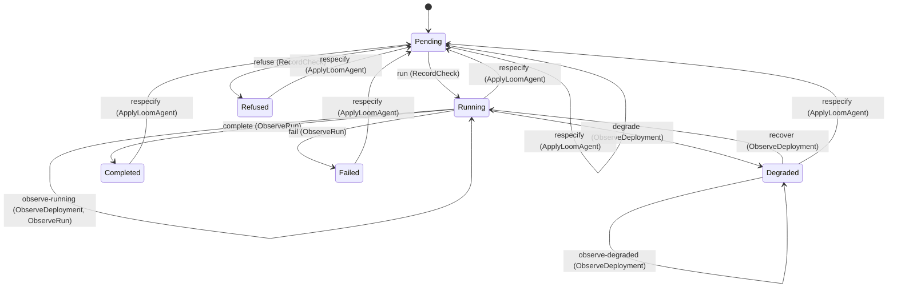

---
# generated by loom-docs, do not edit
title: "Resource domain"
sidebar_label: "Resource"
description: "ESS reference for the Resource domain, generated from the specification."
custom_edit_url: null
---

<!-- generated by loom-docs, do not edit -->

# Resource

The `LoomAgent` custom resource (group `loom.beyond10x.dev`, version `v1alpha1`): its spec, the `loom.agent/1` document and what the pod needs beside it, and its lifecycle as the controller reconciles it: applied into Pending, Running or Refused by the spec check, Degraded and back by the child Deployment's availability, Completed or Failed when the child Job's run ends, with the program's exit code and the time it ended, Pending again on a new generation, and gone on delete.

`loom.resource` is one of loom's bounded contexts. [All domains](./index.mdx).

## Types

### `AgentVariant`

`loom.resource.AgentVariant` is one of `AgentServe` and `Command`.

### `CheckResult`

`loom.resource.CheckResult` is a record of two fields:

- `exit_code` — `Integer`, called `exitCode` on the wire
- `message` — `String`

### `CommandSpec`

`loom.resource.CommandSpec` is a record of two fields:

- `entrypoint` — `Optional<List<String>>`, which may be absent
- `args` — `Optional<List<String>>`, which may be absent

### `Condition`

`loom.resource.Condition` is a record of four fields:

- `type` — `loom.resource.ConditionType`
- `status` — `loom.resource.ConditionStatus`
- `reason` — `String`
- `message` — `String`

### `ConditionStatus`

`loom.resource.ConditionStatus` is one of `True`, `False` and `Unknown`.

### `ConditionType`

`loom.resource.ConditionType` is one of `Checked`, `Available` and `Completed`.

### `ConfigFile`

`loom.resource.ConfigFile` is a record of two fields:

- `name` — `String`
- `content` — `String`

### `ConfinementProfile`

`loom.resource.ConfinementProfile` is a record of two fields:

- `type` — `loom.resource.ConfinementProfileKind`
- `localhost_profile` — `Optional<String>`, which may be absent, called `localhostProfile` on the wire

### `ConfinementProfileKind`

`loom.resource.ConfinementProfileKind` is one of `RuntimeDefault`, `Localhost` and `Unconfined`.

### `DeploymentAvailability`

`loom.resource.DeploymentAvailability` is one of `Available` and `Unavailable`.

### `DeploymentStatus`

`loom.resource.DeploymentStatus` is a record of one field:

- `availability` — `loom.resource.DeploymentAvailability`

### `EnvVar`

`loom.resource.EnvVar` is a record of two fields:

- `name` — `String`
- `value` — `String`

### `ImageRef`

`loom.resource.ImageRef` is a record of two fields:

- `repository` — `String`
- `tag` — `String`

### `LoomAgentSpec`

`loom.resource.LoomAgentSpec` is a record of 12 fields:

- `agent` — `Optional<loom.agent.AgentSpec>`, which may be absent
- `routes` — `Json`
- `connectors_config` — `Optional<String>`, which may be absent, called `connectorsConfig` on the wire
- `secret_ref` — `Optional<loom.resource.SecretRef>`, which may be absent, called `secretRef` on the wire
- `secret_files` — `Optional<loom.resource.SecretFiles>`, which may be absent, called `secretFiles` on the wire
- `env` — `Optional<List<loom.resource.EnvVar>>`, which may be absent
- `image` — `Optional<loom.resource.ImageRef>`, which may be absent
- `command` — `Optional<loom.resource.CommandSpec>`, which may be absent
- `workspace` — `Optional<loom.resource.Workspace>`, which may be absent
- `config_files` — `Optional<List<loom.resource.ConfigFile>>`, which may be absent, called `configFiles` on the wire
- `seccomp_profile` — `Optional<loom.resource.ConfinementProfile>`, which may be absent, called `seccompProfile` on the wire
- `app_armor_profile` — `Optional<loom.resource.ConfinementProfile>`, which may be absent, called `appArmorProfile` on the wire

### `ResourceName`

`loom.resource.ResourceName` wraps `String` and is not interchangeable with one: the whole value of naming it separately is the crossings the model then refuses.

### `RunEnd`

`loom.resource.RunEnd` is a record of three fields:

- `exit_code` — `Optional<Integer>`, which may be absent, called `exitCode` on the wire
- `finished_at` — `Optional<Timestamp>`, which may be absent, called `finishedAt` on the wire
- `reason` — `Optional<String>`, which may be absent

### `RunPhase`

`loom.resource.RunPhase` is one of `Active`, `Succeeded` and `Failed`.

### `SecretFiles`

`loom.resource.SecretFiles` is a record of two fields:

- `name` — `String`
- `mount_path` — `String`, called `mountPath` on the wire

### `SecretRef`

`loom.resource.SecretRef` is a record of one field:

- `name` — `String`

### `Workspace`

`loom.resource.Workspace` is a record of two fields:

- `mount_path` — `String`, called `mountPath` on the wire
- `claim_name` — `Optional<String>`, which may be absent, called `claimName` on the wire

One of the types above is reached by nothing else in this system: `loom.resource.LoomAgentSpec`. No entity, view, command, event, error or crossing names it, so it is either vocabulary something outside this specification uses or a leftover — and only a person can tell which.

## Entities

An entity is what this context is about: something with an identity that outlives any one request, a shape, and a lifecycle. The lifecycle is exhaustive — a move that is not drawn below is a move this specification does not permit, and that is the only way it says so. Every move is labelled with the command that takes it, because a move nothing can trigger is refused rather than drawn.

### `LoomAgent`

`loom.resource.LoomAgent`.

An instance is identified by `name`, a `loom.resource.ResourceName`. The name is part of the model and not a convention: a view projects the identity under that name, so a projection inventing its own would disagree with the view.

It holds:

- `observed_generation` — `Integer`, called `observedGeneration` on the wire
- `check` — `Optional<loom.resource.CheckResult>`, which may be absent
- `deployment` — `Optional<loom.resource.DeploymentStatus>`, which may be absent
- `variant` — `Optional<loom.resource.AgentVariant>`, which may be absent
- `run` — `Optional<loom.resource.RunEnd>`, which may be absent
- `conditions` — `Optional<List<loom.resource.Condition>>`, which may be absent

It declares no relation to another entity, and no other entity names it.

No invariant is declared, so nothing here constrains an instance at rest.

Its state is a `loom.resource.LoomAgent.State`, one of `Completed`, `Degraded`, `Failed`, `Pending`, `Refused` and `Running`. That enum is synthesised from the lifecycle rather than declared beside it, so the states a view's filter compares and the states drawn below cannot disagree.

An instance is created in `Pending`. No state is terminal: nothing in this lifecycle says an instance may stop moving.

Each move is taken by a declared command outcome, and a move nothing takes is refused as `missing_causation` rather than left as a state change nobody can trigger:

- `run` — taken by `loom.resource.RecordCheck` on its `running` outcome
- `refuse` — taken by `loom.resource.RecordCheck` on its `refused` outcome
- `degrade` — taken by `loom.resource.ObserveDeployment` on its `degraded` outcome
- `recover` — taken by `loom.resource.ObserveDeployment` on its `recovered` outcome
- `observe-running` — taken by `loom.resource.ObserveDeployment` on its `still-running` outcome and `loom.resource.ObserveRun` on its `still-active` outcome
- `observe-degraded` — taken by `loom.resource.ObserveDeployment` on its `still-degraded` outcome
- `complete` — taken by `loom.resource.ObserveRun` on its `completed` outcome
- `fail` — taken by `loom.resource.ObserveRun` on its `failed` outcome
- `respecify` — taken by `loom.resource.ApplyLoomAgent` on its `respecified` outcome

An instance is brought into existence by `loom.resource.ApplyLoomAgent` on its `created` outcome.

Illegal transitions are illegal by absence: no rule forbids them, there is simply no arrow, because a rule would be a second place for the same truth to live. A diagram cannot show an absence, so the pairs it does not connect are listed here, derived from the same transitions — anything named below is a move this specification does not permit.

- `Completed` may not become `Degraded`
- `Completed` may not become `Failed`
- `Completed` may not become `Refused`
- `Completed` may not become `Running`
- `Degraded` may not become `Completed`
- `Degraded` may not become `Failed`
- `Degraded` may not become `Refused`
- `Failed` may not become `Completed`
- `Failed` may not become `Degraded`
- `Failed` may not become `Refused`
- `Failed` may not become `Running`
- `Pending` may not become `Completed`
- `Pending` may not become `Degraded`
- `Pending` may not become `Failed`
- `Refused` may not become `Completed`
- `Refused` may not become `Degraded`
- `Refused` may not become `Failed`
- `Refused` may not become `Running`
- `Running` may not become `Refused`

One view projects it: [`LoomAgents`](#loomagents).

## Views

A view is what the outside world is promised it can observe. Each one says which instances it contains and how soon it reflects a command that has already returned, because "you can read this" without "how soon" is the promise every flaky suite is built on.

### `LoomAgents`

`loom.resource.LoomAgents`.

It reads [`LoomAgent`](#loomagent).

It contains every instance of that entity: no filter narrows it, which is a decision somebody made and not a line somebody omitted.

It exposes:

- `name` — `loom.resource.ResourceName`
- `observed_generation` — `Integer`
- `check` — `Optional<loom.resource.CheckResult>`, which may be absent
- `deployment` — `Optional<loom.resource.DeploymentStatus>`, which may be absent
- `variant` — `Optional<loom.resource.AgentVariant>`, which may be absent
- `run` — `Optional<loom.resource.RunEnd>`, which may be absent
- `conditions` — `Optional<List<loom.resource.Condition>>`, which may be absent
- `state` — `loom.resource.LoomAgent.State`

It declares no order, so the rows come back in whatever order the implementation has, and two reads may disagree.

**Read-your-writes**: it is current the moment the command that changed it returns. A caller that has just created an invoice and cannot see it in here has been told a lie about what it did.

A generated scenario asserts it once, immediately after the command: a view promising this and not keeping the promise has to fail the suite rather than be retried until it passes.

## Commands

### `ApplyLoomAgent`

`loom.resource.ApplyLoomAgent`.

It takes:

- `name` — `loom.resource.ResourceName`
- `generation` — `Integer`

It has four outcomes.

**`created`** — Taken when no record carries the identity the command names, and no input-guarded refusal applies; it creates that record. It creates a `loom.resource.LoomAgent`, which starts in `Pending`. The new instance's identity is published as `name` on `loom.resource.LoomAgentApplied`. It emits `loom.resource.LoomAgentApplied`. It sets `observed_generation` from `input.generation`. A test reaches it by sending an identity no record carries, arranging nothing.

**`stale`** — Taken when the existing subject's stored fields satisfy `observed_generation > input.generation`. No entity in this specification changes. It reports `loom.resource.StaleGeneration`, carrying `name`, `generation` and `observed_generation`. It emits nothing. A test establishes and independently observes the subject enum fact before selecting this branch.

**`unchanged`** — Taken when the existing subject's stored fields satisfy `observed_generation == input.generation`. It preserves the existing subject, without an error or event. The instance is the one named by the input field `name`. It emits nothing. A test establishes and independently observes the subject enum fact before selecting this branch.

**`respecified`** — The default branch, taken when no other outcome's condition matched. It moves a `loom.resource.LoomAgent` from `Completed`, `Degraded`, `Failed`, `Pending`, `Refused` and `Running` to `Pending`, along the declared move `respecify`. The instance is the one named by the input field `name`. It emits `loom.resource.LoomAgentApplied`. It sets `observed_generation` from `input.generation`, `check` cleared, `deployment` cleared, `variant` cleared and `run` cleared. A test reaches it by constructing an input that satisfies no other outcome's condition.

### `DeleteLoomAgent`

`loom.resource.DeleteLoomAgent`.

It takes:

- `name` — `loom.resource.ResourceName`

It has two outcomes.

**`deleted`** — The default branch, taken when no other outcome's condition matched. It removes the `loom.resource.LoomAgent` its input names; no view shows it afterwards. The instance is the one named by the input field `name`. It emits `loom.resource.LoomAgentDeleted`. A test reaches it by constructing an input that satisfies no other outcome's condition.

**`unknown`** — Taken when the identity the command names is one no record carries, before any other answer for it. No entity in this specification changes. It reports `loom.resource.LoomAgentNotFound`, carrying `name`. It emits nothing. A test reaches it by sending an identity no record carries, arranging nothing.

### `ObserveDeployment`

`loom.resource.ObserveDeployment`.

It takes:

- `name` — `loom.resource.ResourceName`
- `availability` — `loom.resource.DeploymentAvailability`

It has six outcomes.

**`unknown`** — Taken when the identity the command names is one no record carries, before any other answer for it. No entity in this specification changes. It reports `loom.resource.LoomAgentNotFound`, carrying `name`. It emits nothing. A test reaches it by sending an identity no record carries, arranging nothing.

**`degraded`** — Taken when the existing subject is in Running and `availability == Unavailable` holds of the input. It moves a `loom.resource.LoomAgent` from `Running` to `Degraded`, along the declared move `degrade`. The instance is the one named by the input field `name`. It emits `loom.resource.LoomAgentDegraded`. It sets `deployment` from `{availability: input.availability}`. A test establishes the declared subject state and constructs input selecting this branch in that state.

**`still-running`** — Taken when the existing subject is in Running and `availability == Available` holds of the input. It moves a `loom.resource.LoomAgent` from `Running` to `Running`, along the declared move `observe-running`. The instance is the one named by the input field `name`. It emits `loom.resource.LoomAgentObserved`. It sets `deployment` from `{availability: input.availability}`. A test establishes the declared subject state and constructs input selecting this branch in that state.

**`recovered`** — Taken when the existing subject is in Degraded and `availability == Available` holds of the input. It moves a `loom.resource.LoomAgent` from `Degraded` to `Running`, along the declared move `recover`. The instance is the one named by the input field `name`. It emits `loom.resource.LoomAgentRecovered`. It sets `deployment` from `{availability: input.availability}`. A test establishes the declared subject state and constructs input selecting this branch in that state.

**`still-degraded`** — Taken when the existing subject is in Degraded and `availability == Unavailable` holds of the input. It moves a `loom.resource.LoomAgent` from `Degraded` to `Degraded`, along the declared move `observe-degraded`. The instance is the one named by the input field `name`. It emits `loom.resource.LoomAgentObserved`. It sets `deployment` from `{availability: input.availability}`. A test establishes the declared subject state and constructs input selecting this branch in that state.

**`no-deployment`** — The default branch, taken when no other outcome's condition matched. No entity in this specification changes. It reports `loom.resource.LoomAgentStateConflict`, carrying `name`. It emits nothing. A test reaches it by constructing an input that satisfies no other outcome's condition.

### `ObserveRun`

`loom.resource.ObserveRun`.

It takes:

- `name` — `loom.resource.ResourceName`
- `phase` — `loom.resource.RunPhase`
- `exit_code` — `Optional<Integer>`, which may be absent
- `finished_at` — `Optional<Timestamp>`, which may be absent
- `reason` — `Optional<String>`, which may be absent

It has six outcomes.

**`unknown`** — Taken when the identity the command names is one no record carries, before any other answer for it. No entity in this specification changes. It reports `loom.resource.LoomAgentNotFound`, carrying `name`. It emits nothing. A test reaches it by sending an identity no record carries, arranging nothing.

**`still-active`** — Taken when the existing subject is in Running and `phase == Active` holds of the input. It moves a `loom.resource.LoomAgent` from `Running` to `Running`, along the declared move `observe-running`. The instance is the one named by the input field `name`. It emits `loom.resource.LoomAgentRunObserved`. A test establishes the declared subject state and constructs input selecting this branch in that state.

**`completed`** — Taken when the existing subject is in Running and `phase == Succeeded` holds of the input. It moves a `loom.resource.LoomAgent` from `Running` to `Completed`, along the declared move `complete`. The instance is the one named by the input field `name`. It emits `loom.resource.LoomAgentCompleted`. It sets `run` from `{exit_code: input.exit_code, finished_at: input.finished_at, reason: input.reason}`. A test establishes the declared subject state and constructs input selecting this branch in that state.

**`failed`** — Taken when the existing subject is in Running and `phase == Failed` holds of the input. It moves a `loom.resource.LoomAgent` from `Running` to `Failed`, along the declared move `fail`. The instance is the one named by the input field `name`. It emits `loom.resource.LoomAgentFailed`. It sets `run` from `{exit_code: input.exit_code, finished_at: input.finished_at, reason: input.reason}`. A test establishes the declared subject state and constructs input selecting this branch in that state.

**`finished`** — Taken when the existing subject is in Completed or Failed. It preserves the existing subject, without an error or event. The instance is the one named by the input field `name`. It emits nothing. A test establishes the declared subject state and constructs input selecting this branch in that state.

**`no-run`** — The default branch, taken when no other outcome's condition matched. No entity in this specification changes. It reports `loom.resource.LoomAgentStateConflict`, carrying `name`. It emits nothing. A test reaches it by constructing an input that satisfies no other outcome's condition.

### `RecordCheck`

`loom.resource.RecordCheck`.

It takes:

- `name` — `loom.resource.ResourceName`
- `generation` — `Integer`
- `exit_code` — `Integer`
- `message` — `String`
- `variant` — `loom.resource.AgentVariant`

It has five outcomes.

**`unknown`** — Taken when the identity the command names is one no record carries, before any other answer for it. No entity in this specification changes. It reports `loom.resource.LoomAgentNotFound`, carrying `name`. It emits nothing. A test reaches it by sending an identity no record carries, arranging nothing.

**`stale`** — Taken when the existing subject's stored fields satisfy `observed_generation != input.generation`. No entity in this specification changes. It reports `loom.resource.StaleGeneration`, carrying `name`, `generation` and `observed_generation`. It emits nothing. A test establishes and independently observes the subject enum fact before selecting this branch.

**`running`** — Taken when `exit_code == 0` holds of the input. It moves a `loom.resource.LoomAgent` from `Pending` to `Running`, along the declared move `run`. The instance is the one named by the input field `name`. It emits `loom.resource.LoomAgentRunning`. It sets `check` from `{exit_code: input.exit_code, message: input.message}` and `variant` from `input.variant`. A test reaches it by constructing an input that satisfies that condition.

**`refused`** — The default branch, taken when no other outcome's condition matched. It moves a `loom.resource.LoomAgent` from `Pending` to `Refused`, along the declared move `refuse`. The instance is the one named by the input field `name`. It emits `loom.resource.LoomAgentRefused`. It sets `check` from `{exit_code: input.exit_code, message: input.message}` and `variant` from `input.variant`. A test reaches it by constructing an input that satisfies no other outcome's condition.

**`out-of-order`** — Taken when the subject is resting in a state none of this command's moves start from — a `loom.resource.LoomAgent` in `Completed`, `Degraded`, `Failed`, `Refused` and `Running`, which is what is left of the lifecycle once this command's own moves are taken away. The document lists none of it. No entity in this specification changes. It reports `loom.resource.LoomAgentStateConflict`, carrying `name`. It emits nothing. A test reaches it by driving an instance into one of those states and then issuing the command, because no input selects this branch.

## Events

### `LoomAgentApplied`

`loom.resource.LoomAgentApplied`.

It carries:

- `name` — `loom.resource.ResourceName`
- `generation` — `Integer`

Emitted by `loom.resource.ApplyLoomAgent` on its `created` and `respecified` outcomes.

Nothing in this system reacts to it.

### `LoomAgentCompleted`

`loom.resource.LoomAgentCompleted`.

It carries:

- `name` — `loom.resource.ResourceName`
- `generation` — `Integer`
- `exit_code` — `Optional<Integer>`, which may be absent

Emitted by `loom.resource.ObserveRun` on its `completed` outcome.

Nothing in this system reacts to it.

### `LoomAgentDegraded`

`loom.resource.LoomAgentDegraded`.

It carries:

- `name` — `loom.resource.ResourceName`

Emitted by `loom.resource.ObserveDeployment` on its `degraded` outcome.

Nothing in this system reacts to it.

### `LoomAgentDeleted`

`loom.resource.LoomAgentDeleted`.

It carries:

- `name` — `loom.resource.ResourceName`

Emitted by `loom.resource.DeleteLoomAgent` on its `deleted` outcome.

Nothing in this system reacts to it.

### `LoomAgentFailed`

`loom.resource.LoomAgentFailed`.

It carries:

- `name` — `loom.resource.ResourceName`
- `generation` — `Integer`
- `exit_code` — `Optional<Integer>`, which may be absent

Emitted by `loom.resource.ObserveRun` on its `failed` outcome.

Nothing in this system reacts to it.

### `LoomAgentObserved`

`loom.resource.LoomAgentObserved`.

It carries:

- `name` — `loom.resource.ResourceName`
- `availability` — `loom.resource.DeploymentAvailability`

Emitted by `loom.resource.ObserveDeployment` on its `still-running` and `still-degraded` outcomes.

Nothing in this system reacts to it.

### `LoomAgentRecovered`

`loom.resource.LoomAgentRecovered`.

It carries:

- `name` — `loom.resource.ResourceName`

Emitted by `loom.resource.ObserveDeployment` on its `recovered` outcome.

Nothing in this system reacts to it.

### `LoomAgentRefused`

`loom.resource.LoomAgentRefused`.

It carries:

- `name` — `loom.resource.ResourceName`
- `generation` — `Integer`
- `message` — `String`

Emitted by `loom.resource.RecordCheck` on its `refused` outcome.

Nothing in this system reacts to it.

### `LoomAgentRunObserved`

`loom.resource.LoomAgentRunObserved`.

It carries:

- `name` — `loom.resource.ResourceName`
- `generation` — `Integer`

Emitted by `loom.resource.ObserveRun` on its `still-active` outcome.

Nothing in this system reacts to it.

### `LoomAgentRunning`

`loom.resource.LoomAgentRunning`.

It carries:

- `name` — `loom.resource.ResourceName`
- `generation` — `Integer`

Emitted by `loom.resource.RecordCheck` on its `running` outcome.

Nothing in this system reacts to it.

## Errors

### `LoomAgentNotFound`

It carries:

- `name` — `loom.resource.ResourceName`

Reported by `loom.resource.DeleteLoomAgent` on its `unknown` outcome.

Reported by `loom.resource.ObserveDeployment` on its `unknown` outcome.

Reported by `loom.resource.ObserveRun` on its `unknown` outcome.

Reported by `loom.resource.RecordCheck` on its `unknown` outcome.

### `LoomAgentStateConflict`

It carries:

- `name` — `loom.resource.ResourceName`

Reported by `loom.resource.ObserveDeployment` on its `no-deployment` outcome.

Reported by `loom.resource.ObserveRun` on its `no-run` outcome.

Reported by `loom.resource.RecordCheck` on its `out-of-order` outcome.

### `StaleGeneration`

It carries:

- `name` — `loom.resource.ResourceName`
- `generation` — `Integer`
- `observed_generation` — `Integer`

Reported by `loom.resource.ApplyLoomAgent` on its `stale` outcome.

Reported by `loom.resource.RecordCheck` on its `stale` outcome.

---

Generated from loom v1 · model digest `9cec9c3c2e445f734256674d6a028fa1ac291ff09f2d6dc173d78cfd492469e9` · contract digest `slice-sha256/2:9fcf611664ef86d9c3a96340e67733092fe768af59226622155d137b7892cbe6`. Do not edit this file; change the specification and regenerate it with `task docs-generate`.
