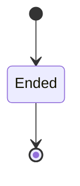

---
# generated by loom-docs, do not edit
title: "Session domain"
sidebar_label: "Session"
description: "ESS reference for the Session domain, generated from the specification."
custom_edit_url: null
---

<!-- generated by loom-docs, do not edit -->

# Session

The agent session an AgentExecutor runs through metaharness (harness, Claude Code or Codex) in a scratch copy of the workspace, and the change it returns as a proposed action. Proposed and applied are states of Commission's ActionRequest, not of the session: a session is one record.

`loom.session` is one of loom's bounded contexts. [All domains](./index.mdx).

## Types

### `CallDecision`

`loom.session.CallDecision` is one of `Allow`, `Deny`, `Replace` and `Abstain`.

### `ChangedFile`

`loom.session.ChangedFile` is a record of two fields:

- `path` — `String`
- `content` — `Optional<String>`, which may be absent

### `ChildEnd`

`loom.session.ChildEnd` is one of `Exited`, `Signaled` and `NotMeasured`.

### `CommissionId`

`loom.session.CommissionId` wraps `Uuid` and is not interchangeable with one: the whole value of naming it separately is the crossings the model then refuses.

### `DecidedBy`

`loom.session.DecidedBy` is one of `Embedder`, `Frame`, `Deadline`, `Adapter` and `Observe`.

### `FailureRefusalReason`

`loom.session.FailureRefusalReason` is one of `UnmeasuredWithCode` and `MeasuredWithoutCode`.

### `FrontierId`

`loom.session.FrontierId` wraps `Uuid` and is not interchangeable with one: the whole value of naming it separately is the crossings the model then refuses.

### `SessionFailure`

`loom.session.SessionFailure` is a record of four fields:

- `end` — `loom.session.ChildEnd`
- `code` — `Optional<Integer>`, which may be absent
- `stderr_tail` — `Optional<String>`, which may be absent
- `reason` — `Optional<String>`, which may be absent

### `SessionId`

`loom.session.SessionId` wraps `Uuid` and is not interchangeable with one: the whole value of naming it separately is the crossings the model then refuses.

### `SessionKind`

`loom.session.SessionKind` is one of `ClaudeCode`, `Codex` and `Harness`.

### `ToolDecision`

`loom.session.ToolDecision` is a record of five fields:

- `call_id` — `String`
- `tool` — `Optional<String>`, which may be absent
- `decision` — `loom.session.CallDecision`
- `reason` — `Optional<String>`, which may be absent
- `decided_by` — `loom.session.DecidedBy`

One of the types above is reached by nothing else in this system: `loom.session.ToolDecision`. No entity, view, command, event, error or crossing names it, so it is either vocabulary something outside this specification uses or a leftover — and only a person can tell which.

## Entities

An entity is what this context is about: something with an identity that outlives any one request, a shape, and a lifecycle. The lifecycle is exhaustive — a move that is not drawn below is a move this specification does not permit, and that is the only way it says so. Every move is labelled with the command that takes it, because a move nothing can trigger is refused rather than drawn.

### `AgentSession`

`loom.session.AgentSession`.

An instance is identified by `session_id`, a `loom.session.SessionId`. The name is part of the model and not a convention: a view projects the identity under that name, so a projection inventing its own would disagree with the view.

It holds:

- `kind` — `loom.session.SessionKind`
- `commission_id` — `loom.session.CommissionId`
- `frontier_id` — `loom.session.FrontierId`
- `vendor_session_id` — `Optional<String>`, which may be absent
- `agent` — `Optional<loom.agent.AgentId>`, which may be absent
- `continues` — `Optional<loom.session.SessionId>`, which may be absent
- `action` — `String`
- `files` — `List<loom.session.ChangedFile>`
- `failure` — `Optional<loom.session.SessionFailure>`, which may be absent

It references at most one [`AgentSession`](#agentsession), as `predecessor`, carried by `AgentSession.continues`.

No invariant is declared, so nothing here constrains an instance at rest.

Its state is a `loom.session.AgentSession.State`, one of `Ended`. That enum is synthesised from the lifecycle rather than declared beside it, so the states a view's filter compares and the states drawn below cannot disagree.

An instance is created in `Ended`. `Ended` is terminal, so an instance may rest there forever. That is declared rather than inferred from having no way out: an entity that cannot leave a state is either finished or stuck, and only its author knows which.

It declares no moves, so nothing changes its state once it exists.

It has one state, so there is no move to permit or to forbid.

One view projects it: [`AgentSessions`](#agentsessions).

## Views

A view is what the outside world is promised it can observe. Each one says which instances it contains and how soon it reflects a command that has already returned, because "you can read this" without "how soon" is the promise every flaky suite is built on.

### `AgentSessions`

`loom.session.AgentSessions`.

It reads [`AgentSession`](#agentsession).

It contains every instance of that entity: no filter narrows it, which is a decision somebody made and not a line somebody omitted.

It exposes:

- `session_id` — `loom.session.SessionId`
- `kind` — `loom.session.SessionKind`
- `commission_id` — `loom.session.CommissionId`
- `frontier_id` — `loom.session.FrontierId`
- `vendor_session_id` — `Optional<String>`, which may be absent
- `agent` — `Optional<loom.agent.AgentId>`, which may be absent
- `continues` — `Optional<loom.session.SessionId>`, which may be absent
- `action` — `String`
- `files` — `List<loom.session.ChangedFile>`
- `failure` — `Optional<loom.session.SessionFailure>`, which may be absent
- `state` — `loom.session.AgentSession.State`

It declares no order, so the rows come back in whatever order the implementation has, and two reads may disagree.

**Read-your-writes**: it is current the moment the command that changed it returns. A caller that has just created an invoice and cannot see it in here has been told a lie about what it did.

A generated scenario asserts it once, immediately after the command: a view promising this and not keeping the promise has to fail the suite rather than be retried until it passes.

## Commands

### `ProposeSessionChange`

`loom.session.ProposeSessionChange`.

It takes:

- `session_id` — `loom.session.SessionId`
- `kind` — `loom.session.SessionKind`
- `commission_id` — `loom.session.CommissionId`
- `frontier_id` — `loom.session.FrontierId`
- `vendor_session_id` — `Optional<String>`, which may be absent
- `agent` — `Optional<loom.agent.AgentId>`, which may be absent
- `continues` — `Optional<loom.session.SessionId>`, which may be absent
- `action` — `String`
- `files` — `List<loom.session.ChangedFile>`

It has one outcome.

**`proposed`** — The default branch, taken when no other outcome's condition matched. It creates a `loom.session.AgentSession`, which starts in `Ended`. The new instance's identity is published as `session_id` on `loom.session.SessionChangeProposed`. It emits `loom.session.SessionChangeProposed`. It sets `kind` from `input.kind`, `commission_id` from `input.commission_id`, `frontier_id` from `input.frontier_id`, `vendor_session_id` from `input.vendor_session_id`, `agent` from `input.agent`, `continues` from `input.continues`, `action` from `input.action` and `files` from `input.files`. A test reaches it by constructing an input that satisfies no other outcome's condition.

### `RecordFailedSession`

`loom.session.RecordFailedSession`.

It takes:

- `session_id` — `loom.session.SessionId`
- `kind` — `loom.session.SessionKind`
- `commission_id` — `loom.session.CommissionId`
- `frontier_id` — `loom.session.FrontierId`
- `vendor_session_id` — `Optional<String>`, which may be absent
- `agent` — `Optional<loom.agent.AgentId>`, which may be absent
- `continues` — `Optional<loom.session.SessionId>`, which may be absent
- `failure` — `loom.session.SessionFailure`

It has three outcomes.

**`unmeasured-with-code`** — Taken when `(failure.end == NotMeasured and defined(failure.code))` holds of the input. No entity in this specification changes. It reports `loom.session.FailureRefused`, carrying `reason`. It emits nothing. A test reaches it by constructing an input that satisfies that condition.

**`measured-without-code`** — Taken when `(failure.end != NotMeasured and not (defined(failure.code)))` holds of the input. No entity in this specification changes. It reports `loom.session.FailureRefused`, carrying `reason`. It emits nothing. A test reaches it by constructing an input that satisfies that condition.

**`failed`** — The default branch, taken when no other outcome's condition matched. It creates a `loom.session.AgentSession`, which starts in `Ended`. The new instance's identity is published as `session_id` on `loom.session.SessionFailed`. It emits `loom.session.SessionFailed`. It sets `kind` from `input.kind`, `commission_id` from `input.commission_id`, `frontier_id` from `input.frontier_id`, `vendor_session_id` from `input.vendor_session_id`, `agent` from `input.agent`, `continues` from `input.continues`, `action` from `""` and `failure` from `{end: input.failure.end, code: input.failure.code, stderr_tail: input.failure.stderr_tail, reason: implementation-generated}`. A test reaches it by constructing an input that satisfies no other outcome's condition.

## Events

### `SessionChangeProposed`

`loom.session.SessionChangeProposed`.

It carries:

- `session_id` — `loom.session.SessionId`
- `commission_id` — `loom.session.CommissionId`
- `frontier_id` — `loom.session.FrontierId`
- `continues` — `Optional<loom.session.SessionId>`, which may be absent
- `action` — `String`
- `files` — `List<loom.session.ChangedFile>`

Emitted by `loom.session.ProposeSessionChange` on its `proposed` outcome.

Nothing in this system reacts to it.

### `SessionFailed`

`loom.session.SessionFailed`.

It carries:

- `session_id` — `loom.session.SessionId`
- `commission_id` — `loom.session.CommissionId`
- `frontier_id` — `loom.session.FrontierId`
- `continues` — `Optional<loom.session.SessionId>`, which may be absent
- `failure` — `loom.session.SessionFailure`

Emitted by `loom.session.RecordFailedSession` on its `failed` outcome.

Nothing in this system reacts to it.

## Errors

### `FailureRefused`

It carries:

- `reason` — `loom.session.FailureRefusalReason`

Reported by `loom.session.RecordFailedSession` on its `unmeasured-with-code` and `measured-without-code` outcomes.

---

Generated from loom v1 · model digest `e883ecf8aa8c92fc237aff37e49a22699aa6dba3413a77b12bff9ec18761b3c5` · contract digest `slice-sha256/2:b5460d1f391bf696958d711bdd974d5e92637beda4d314ccdcb59f5ec2594770`. Do not edit this file; change the specification and regenerate it with `task docs-generate`.
